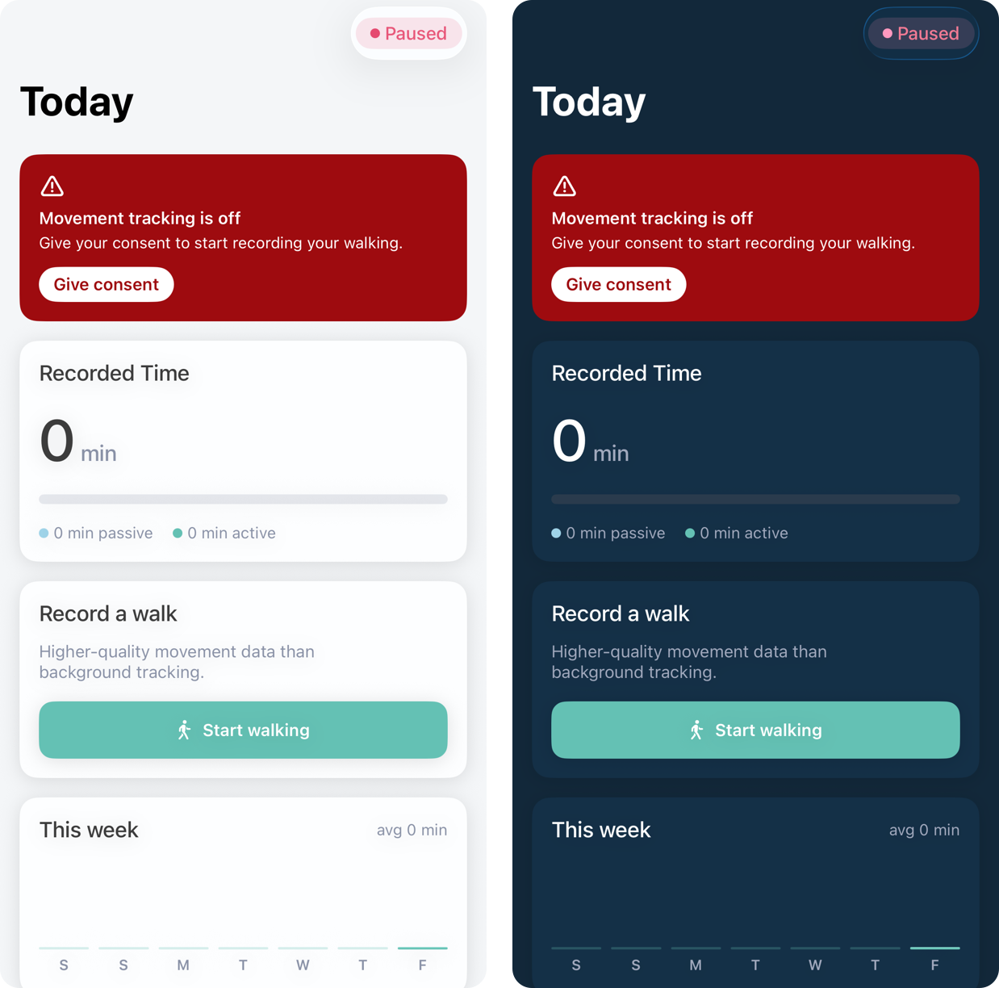

# Kinetikos Tracker SDK for iOS

Add walking tracking and the 6-minute walk test to your iPhone app. The SDK records in the background, sends the recordings to Kinetikos, and works with **your** login: your users never see a Kinetikos screen.

> **Pre-release.** Everything below works today. One extra, silent pushes signed with your own key, is not available yet ([details](docs/using-the-sdk.md#permissions-and-tracking)).

## How it works

```
Your server ──► Kinetikos        "P-17 takes part" · "a token for P-17, please"
Your app    ◄── your server      the token
Your app    ──► SDK ──► Kinetikos   the walking recordings, with that token
```

Your server keeps the secret credentials Kinetikos gives you and hands your app a short-lived token for the person who is signed in. Your app passes that token to the SDK. That's the whole connection.

## Before you start

- **From Kinetikos:** your tenant and client credentials for the environment you'll use (development, staging or production).
- **To Kinetikos:** your app's bundle ID.
- **Your tools:** Xcode 26 or later; the app runs on iOS 17 or later.
- **Your server:** an endpoint that returns a participant token for the signed-in user. It's three small calls; see [Your backend](docs/backend.md).

## Get it running in 5 steps

### 1. Add the package

In Xcode: **File → Add Package Dependencies…**, paste

```
https://github.com/kinetikosio/tracker-sdk-ios
```

choose *Up to Next Major* from the latest version, and add **TrackerSDK** to your app target.

### 2. Paste the project settings

Open your app target's Info.plist as source code and add:

```xml
<key>NSMotionUsageDescription</key>
<string>We use motion sensors to measure your walking.</string>
<key>UIBackgroundModes</key>
<array>
    <string>fetch</string>
    <string>processing</string>
    <string>remote-notification</string>
    <string>audio</string>
</array>
<key>BGTaskSchedulerPermittedIdentifiers</key>
<array>
    <string>$(PRODUCT_BUNDLE_IDENTIFIER).refresh</string>
    <string>$(PRODUCT_BUNDLE_IDENTIFIER).processing</string>
    <string>$(PRODUCT_BUNDLE_IDENTIFIER).overnight</string>
</array>
```

Then in **Signing & Capabilities**, add **Push Notifications** and **Background Modes**, and tick the same four modes.

Change the motion sentence to your own words, but keep everything else exactly as it is. **Without these settings, recording stops whenever your app is closed**, and nothing tells you.

### 3. Paste the app delegate

The SDK needs to hear about app launch, pushes and background uploads. Add this file, and connect it to your app:

```swift
import UIKit
import TrackerSDK

final class AppDelegate: NSObject, UIApplicationDelegate {

    func application(
        _ application: UIApplication,
        didFinishLaunchingWithOptions launchOptions: [UIApplication.LaunchOptionsKey: Any]? = nil
    ) -> Bool {
        // 1. Before anything else. Also runs when iOS launches the app in the background.
        Tracker.configure(environment: .production, tokenProvider: ParticipantTokens.fetch)

        // 2. Must be here: iOS refuses background-task registrations after launch.
        Tracker.registerBackgroundTasks()

        application.registerForRemoteNotifications()
        return true
    }

    func application(_ application: UIApplication,
                     didRegisterForRemoteNotificationsWithDeviceToken deviceToken: Data) {
        Tracker.setPushToken(deviceToken)
    }

    func application(_ application: UIApplication,
                     didReceiveRemoteNotification userInfo: [AnyHashable: Any],
                     fetchCompletionHandler completionHandler: @escaping (UIBackgroundFetchResult) -> Void) {
        let state = application.applicationState
        Task {
            if let result = await Tracker.handleRemoteNotification(userInfo, applicationState: state) {
                completionHandler(result)        // a Kinetikos push
            } else {
                completionHandler(.noData)       // yours: handle it as you already do
            }
        }
    }

    func application(_ application: UIApplication,
                     handleEventsForBackgroundURLSession identifier: String,
                     completionHandler: @escaping () -> Void) {
        if !Tracker.handleBackgroundSession(identifier: identifier, completion: completionHandler) {
            completionHandler()                  // not the SDK's session
        }
    }
}
```

```swift
@main
struct MyApp: App {
    @UIApplicationDelegateAdaptor(AppDelegate.self) var appDelegate
    var body: some Scene { WindowGroup { RootView() } }
}
```

While you test, use `.development` or `.staging` instead of `.production`, with the credentials for that environment.

### 4. Give the SDK a token

`ParticipantTokens.fetch` above is yours to write: it asks **your server** for the signed-in person's token.

```swift
enum ParticipantTokens {
    /// TrackerTokenProvider: `@Sendable @concurrent (_ forceRefresh: Bool) async throws -> String?`
    @Sendable static func fetch(forceRefresh: Bool) async throws -> String? {
        guard let session = MyAuth.storedSession() else { return nil }   // nobody signed in
        if !forceRefresh, let cached = TokenCache.valid() { return cached } // still good for a while
        let token = try await MyBackend.participantToken(using: session)   // your server's token endpoint
        TokenCache.store(token)
        return token
    }
}
```

Three rules: it must work **without showing any screen** (the SDK also calls it in the background), return `nil` when nobody is signed in, and fetch a fresh token when `forceRefresh` is `true`. [More about the token provider](docs/using-the-sdk.md#the-token-provider).

### 5. Ask for consent and start tracking

Nothing is recorded until the person agrees. Show the SDK's consent text with a checkbox, then ask for the motion permission and start:

```swift
let document = Tracker.consentDocument(locale: Locale.current.language.languageCode?.identifier ?? "en")
// Show document.text, and a checkbox labelled document.declaration.

// When they tap "I agree":
await Tracker.giveConsent(version: document.version, locale: document.locale)
await Tracker.requestPermissions()    // the system's Motion & Fitness prompt
await Tracker.startTracking()         // safe to call on every launch
```

**Done.** The SDK now records walking in the background and uploads it by itself, even when your app is closed.

One more line, when the person signs out of your app, **before** your own sign-out:

```swift
await Tracker.signOut()
```

## Test it

Use a **real iPhone** (the simulator has no motion sensors) and the development or staging environment. Go for a walk: iOS hands the walking over to the SDK later, not live. Open the app to trigger an upload.

## Next

- **[Screens you can copy](docs/screens.md)**: ready-made SwiftUI screens for consent, today's walking, the walk test, settings and results, in light and dark mode.
- **[Using the SDK](docs/using-the-sdk.md)**: the walk test, status updates, settings, sign-out, and what the SDK does by itself (revocation, withdrawal, offline).
- **[Your backend](docs/backend.md)**: the three calls your server makes, and what each answer means.
- **[Testing and going live](docs/going-live.md)**: the App Store review note you need, privacy, and a checklist before release.


