# Kinetikos Tracker SDK for iOS — Integration Guide

The SDK records a participant's walking in the background, uploads it to Kinetikos, and runs the 6-minute walk test, inside **your** app. Your users stay in your app and keep your login: the SDK never shows a Kinetikos sign-in, and has no UI of its own.

This guide takes you from an empty project to a working integration. Do the steps in order.

> **Status:** pre-release (spec v0.2). Two items are marked *Not available yet* below; everything else works today.

---

## 1. How it fits together

Two systems of yours talk to Kinetikos: your **backend** and your **app**.

```
Your backend ──(1) client credentials──► Kinetikos   invite / revoke participants
Your backend ──(2) "token for P-17"────► Kinetikos   returns a participant token
Your app ◄──── participant token ──────── your backend
Your app ──► SDK ──(3) data, with token─► Kinetikos   recordings, consent
```

1. **Your backend** holds the client credentials Kinetikos gave you. With them it invites the people who take part (by *your* id for them, the `external_id`), and revokes them when they stop.
2. When your app needs it, **your backend** asks Kinetikos for a **participant token** for one person and passes it to your app. The first token for an invited person also enrolls them.
3. **Your app** gives that token to the SDK, which sends the person's data with it.

**The client credentials never go in your app.** Anything in an app can be extracted. Your app only ever holds participant tokens, which last eight hours and work for one person.

### What you need from Kinetikos

- A **tenant** (your isolated space) and **client credentials** for your backend, with the `participants:write` and `participants:token` scopes.
- Which **environment** to use. Each is a separate Kinetikos backend, with its own tenant and client credentials, and a participant token works only on the backend that issued it: your backend and the SDK must use the same one.

  | Environment | Backend URL (`<host>` below) | In the SDK |
  |---|---|---|
  | Development | `https://tracker-api-dev.kinetikos.io` | `.development` |
  | Staging | `https://tracker-api-stg.kinetikos.io` | `.staging` |
  | Production | `https://tracker-api.kinetikos.io` | `.production` |
- The **SDK package** (see §3).

### What Kinetikos needs from you

- Your app's **bundle ID**.
- *(Not available yet: per-integrator silent pushes; see §5.4)* Your **APNs key** (`.p8`), its key ID, and your team ID.

---

## 2. Your backend

Your backend calls two Kinetikos endpoints. Full reference: the Kinetikos *Integration API* document.

### 2.1 Get your backend's token

```sh
curl -X POST https://<host>/v1/oauth/token \
  -u "$CLIENT_ID:$CLIENT_SECRET" \
  -d grant_type=client_credentials -d scope="participants:write participants:token"
```

Cache it until `expires_in` runs out.

### 2.2 Invite a participant

When someone in your system should be tracked (they joined a programme, a clinician enrolled them…):

```sh
curl -X POST https://<host>/v1/participants -H "Authorization: Bearer $TOKEN" \
  -H 'content-type: application/json' -d '{"external_id":"P-17"}'
```

Inviting the same `external_id` again is safe; it returns the existing invitation. Invite only the people who will actually be tracked.

### 2.3 Give your app participant tokens

Add an endpoint **on your backend** that your app calls with the user's own session (your login). It checks who the user is, then asks Kinetikos for that person's token:

```sh
curl -X POST https://<host>/v1/participant-tokens -H "Authorization: Bearer $TOKEN" \
  -H 'content-type: application/json' -d '{"external_id":"P-17"}'
```

```json
{ "access_token": "eyJhbGciOi...", "token_type": "Bearer", "expires_in": 28800, "participant": { "status": "enrolled", "…": "…" } }
```

- **Only hand a person's token to that person.** Kinetikos trusts your backend to say who is who.
- Tokens last `expires_in` seconds (8 hours). Cache each person's token and fetch a new one shortly before it expires, not on every call. Revoking someone or suspending your institution takes effect at once, whatever token their phone holds.
- `403 PARTICIPANT_REVOKED`: the person was revoked. Don't return a token; your app should stop asking for a while.
- `403 TENANT_INACTIVE`: your institution is suspended or has ended the study. Don't return a token (throw from `tokenProvider`); it works again as soon as the institution is active.
- `404 NOT_FOUND`: never invited. Invite them first, if they should take part.
- `409 ENROLLED_IN_APP`: the person enrolled in the Kinetikos app with their Enrollment Code. Participant tokens are only for people who use the SDK.
- `409 CONFLICT` (rare), `429 TOO_MANY_REQUESTS` (your institution's limit; wait for `Retry-After`) and `503 SERVICE_UNAVAILABLE`: retry later. Meanwhile return your cached token if it is still valid, or throw: the SDK keeps recording and uploads later.

### 2.4 Revoke

When someone should stop being tracked: `POST /v1/participants/{id}/revoke`. Their phone stops recording and deletes what it hadn't sent the next time it talks to Kinetikos. To bring them back, invite them again: they keep their history, but must give consent again in your app.

---

## 3. Add the SDK to your app

**Requirements:** iOS 17 or later. Xcode 26 or later (the SDK is built with Swift 6.2).

The SDK is a pre-built binary framework (`TrackerSDK.xcframework`) with no dependencies of its own. In Xcode choose **File → Add Package Dependencies…**, enter `https://github.com/kinetikosio/tracker-sdk-ios`, choose a version (e.g. *Up to Next Major* from `1.0.0`), and add the **TrackerSDK** library to your app target. Xcode downloads the framework and checks its checksum and signature.

```swift
import TrackerSDK
```

The SDK ships a privacy manifest (`PrivacyInfo.xcprivacy`). Xcode merges it into your app's privacy report. It declares motion (fitness) data and device model / OS version, linked to the participant and never used for tracking.

---

## 4. Configure your Xcode project

iOS doesn't let a library register itself for background work, so your app must declare it. **If you skip any of these, background recording silently stops working.**

### 4.1 Info.plist

| Key | Value | Why |
|---|---|---|
| `NSMotionUsageDescription` | Your wording, e.g. *"We use motion sensors to measure your walking."* | Motion & Fitness permission. Required. |
| `UIBackgroundModes` | `fetch`, `processing`, `remote-notification`, `audio` | Background extraction, uploads, silent-push wake-ups, and keeping walk tests recording with the screen locked. |
| `BGTaskSchedulerPermittedIdentifiers` | `$(PRODUCT_BUNDLE_IDENTIFIER).refresh`<br>`$(PRODUCT_BUNDLE_IDENTIFIER).processing`<br>`$(PRODUCT_BUNDLE_IDENTIFIER).overnight` | The SDK's background tasks. They must be exactly these, built from **your** bundle ID. |

As XML:

```xml
<key>NSMotionUsageDescription</key>
<string>We use motion sensors to measure your walking.</string>
<key>UIBackgroundModes</key>
<array>
    <string>fetch</string>
    <string>processing</string>
    <string>remote-notification</string>
    <string>audio</string>
</array>
<key>BGTaskSchedulerPermittedIdentifiers</key>
<array>
    <string>$(PRODUCT_BUNDLE_IDENTIFIER).refresh</string>
    <string>$(PRODUCT_BUNDLE_IDENTIFIER).processing</string>
    <string>$(PRODUCT_BUNDLE_IDENTIFIER).overnight</string>
</array>
```

### 4.2 Capabilities

In **Signing & Capabilities**, add **Push Notifications** and **Background Modes** (tick the four modes above).

### 4.3 App Store review: the `audio` background mode

The SDK plays **silent audio** while a manual recording or a walk test is running, so the recording continues while the screen is locked. Background tracking doesn't use it. Reviewers may ask why an app that plays no sound declares `audio`. In **App Review Information → Notes**, explain:

> *"The app records a timed walking test (6 minutes) using the motion sensors. To keep recording while the phone is locked in the user's pocket, the embedded Kinetikos SDK plays silent audio only while a test is running. No audio is played or recorded otherwise."*

---

## 5. Code

### 5.1 App delegate

The SDK needs four system events. In a SwiftUI app, add an app delegate with `@UIApplicationDelegateAdaptor`.

```swift
import UIKit
import TrackerSDK

final class AppDelegate: NSObject, UIApplicationDelegate {

    func application(
        _ application: UIApplication,
        didFinishLaunchingWithOptions launchOptions: [UIApplication.LaunchOptionsKey: Any]? = nil
    ) -> Bool {
        // 1. Before anything else. Also runs when iOS launches the app in the background.
        Tracker.configure(environment: .production, tokenProvider: ParticipantTokens.fetch)

        // 2. Must be here: iOS refuses background-task registrations after launch.
        Tracker.registerBackgroundTasks()

        application.registerForRemoteNotifications()
        return true
    }

    func application(_ application: UIApplication,
                     didRegisterForRemoteNotificationsWithDeviceToken deviceToken: Data) {
        Tracker.setPushToken(deviceToken)
    }

    func application(_ application: UIApplication,
                     didReceiveRemoteNotification userInfo: [AnyHashable: Any],
                     fetchCompletionHandler completionHandler: @escaping (UIBackgroundFetchResult) -> Void) {
        let state = application.applicationState
        Task {
            if let result = await Tracker.handleRemoteNotification(userInfo, applicationState: state) {
                completionHandler(result)        // a Kinetikos push
            } else {
                completionHandler(.noData)       // yours: handle it as you already do
            }
        }
    }

    func application(_ application: UIApplication,
                     handleEventsForBackgroundURLSession identifier: String,
                     completionHandler: @escaping () -> Void) {
        if !Tracker.handleBackgroundSession(identifier: identifier, completion: completionHandler) {
            completionHandler()                  // not the SDK's session
        }
    }
}
```

```swift
@main
struct MyApp: App {
    @UIApplicationDelegateAdaptor(AppDelegate.self) var appDelegate
    var body: some Scene { WindowGroup { RootView() } }
}
```

Use `.development` or `.staging` while testing, with the credentials Kinetikos gives you for that environment (§1). `.custom(URL)` points at any other Kinetikos backend you are given. The same SDK version works with every environment.

### 5.2 The token provider

The SDK calls your `tokenProvider` whenever it needs a token, including **when the app was woken in the background with no UI** (a silent push or background task gives about 30 seconds). It must:

- return a participant token from your backend (§2.3), using the session your app keeps, e.g. a refresh token in the keychain;
- when `forceRefresh` is `true`, fetch a **new** token instead of returning a cached one: the SDK passes it after Kinetikos refused the last token (it expired), and then retries the request once;
- **never show UI** or wait for the user to sign in;
- return `nil` when nobody is signed in to your app;
- throw for a temporary failure (offline, timeout). The SDK keeps recording and tries again later.

```swift
enum ParticipantTokens {
    /// TrackerTokenProvider: `@Sendable @concurrent (_ forceRefresh: Bool) async throws -> String?`
    @Sendable static func fetch(forceRefresh: Bool) async throws -> String? {
        guard let session = MyAuth.storedSession() else { return nil }   // nobody signed in
        if !forceRefresh, let cached = TokenCache.valid() { return cached } // still good for a while
        let token = try await MyBackend.participantToken(using: session)   // your §2.3 endpoint
        TokenCache.store(token)
        return token
    }
}
```

The SDK reads which participant a token is for. **If a token is for a different person than before, the SDK first deletes everything the previous person left on the phone**, so data can never go up under the wrong person.

### 5.3 Consent

Nothing is recorded until the person gives consent in your app. Show the SDK's consent text, with a checkbox for the declaration, and record the agreement:

```swift
let document = Tracker.consentDocument(locale: Locale.current.language.languageCode?.identifier ?? "en")
// Show document.text (paragraphs separated by a blank line),
// and a checkbox labelled document.declaration. Enable "I agree" once it's ticked.

// On "I agree":
let recorded = await Tracker.giveConsent(version: document.version, locale: document.locale)
// false = no participant yet: your tokenProvider returned nil. Make sure the user is signed in.
```

- The text is available in English and Portuguese; any other language gets English.
- Consent works offline and is sent to Kinetikos as soon as possible. Uploads wait until Kinetikos has received it.
- `Tracker.withdrawConsent()` records a withdrawal: recording stops at once. The person can consent again later. Offer it somewhere in your settings.

### 5.4 Permissions and tracking

After consent, ask for the Motion & Fitness permission, then start tracking:

```swift
let granted = await Tracker.requestPermissions()    // shows the system prompt if needed
await Tracker.startTracking()
```

- The SDK **never prompts on its own**; you decide when. `Tracker.permissions()` tells you what's granted. If the person denied it, send them to Settings (`UIApplication.openSettingsURLString`).
- `startTracking()` is remembered across launches and reboots. It's safe, and recommended, to call it on every launch once the person is signed in.
- `stopTracking()` pauses background recording without withdrawing consent.

*Not available yet: per-integrator silent pushes.* Kinetikos wakes phones with silent pushes so background recording keeps going, and that needs pushes signed with **your** APNs key. Until that's supported, the SDK relies on iOS background tasks alone. Recording still works, but iOS runs those tasks less often when the app isn't opened. Keep the push code from §5.1 in place: it starts working without an app update.

### 5.5 Manual recording and the 6-minute walk test

```swift
await Tracker.startWalkTest()          // false if something is already recording
await Tracker.stopWalkTest()           // stopping early discards the test

await Tracker.startManualRecording()   // the person stops it themselves
await Tracker.stopManualRecording()    // saved and uploaded
```

The walk test runs for `Tracker.walkTestDurationSeconds` (6 minutes) and fails if the person stops moving for `Tracker.walkTestIdleTimeoutSeconds` (45 seconds). Only a completed test is uploaded.

### 5.6 Status and events

```swift
// Follow the status, e.g. in a view model:
for await status in Tracker.statusUpdates() {
    switch status.state {
    case .needsConsent:     showConsent()
    case .needsPermissions: showPermissionHelp()
    case .revoked:          showNoLongerTracked()
    case .studyInactive:    showStudyNotActive()
    case .withdrawn:        showConsentWithdrawn()
    case .active, .stopped, .signedOut, .notConfigured: break
    }
    countdown = status.walkTest.remainingSeconds   // while status.walkTest.running
}

// One-off events:
for await event in Tracker.events() {
    if case .walkTestFinished(let outcome) = event { showResult(outcome) }
}
```

`state` reports the first thing in the way, in this order: `notConfigured`, `signedOut`, `revoked`, `studyInactive`, `withdrawn`, `needsConsent`, `needsPermissions`, `stopped`, `active`. `status.sync` tells you how many recordings are waiting to upload and when the last upload happened. `walkTest.remainingSeconds` is computed when you read it, so refresh it every second to show a countdown.

### 5.7 Sync and mobile data

The SDK uploads by itself, on Wi-Fi by default. `Tracker.setAllowCellular(true)` lets it use mobile data; `Tracker.allowCellular` reads the current setting, for your own toggle. `await Tracker.syncNow()` uploads now, e.g. from a "Sync" button, and asks Kinetikos for the participant's Consent first.

### 5.8 Sign-out

Call it when the person signs out of **your** app, **before** your own sign-out, so a last upload can still get a token:

```swift
await Tracker.signOut()
await MyAuth.signOut()
```

The SDK stops, spends up to 5 seconds uploading what's pending, then stops sending anything. What couldn't be sent stays on the phone:
- **The same person signs in again:** it uploads.
- **Someone else signs in:** it's deleted before their first token is used.
- **Nobody signs back in:** it's deleted after 90 days.

Call `startTracking()` again after the next sign-in.

---

## 6. What the SDK does on its own

| Situation | What happens |
|---|---|
| Revoked by your backend | Recording stops; what wasn't sent is deleted; `state` is `revoked`, and the `revoked` event fires. A new invitation brings the person back: they keep their history but must give consent again (`needsConsent`). |
| Institution suspended, or the study ended | Recording and uploads stop; what was recorded before stays on the phone. `state` is `studyInactive`, and the `studyInactive` event fires. The SDK checks every 15 minutes or so while it runs, and when the institution is active again everything resumes by itself, with no new sign-in. |
| Consent withdrawn (in your app, or by Kinetikos staff) | Recording stops; anything recorded after the withdrawal is deleted unsent. `state` is `withdrawn`. |
| Offline | Recordings are kept and uploaded later. |
| `tokenProvider` returns `nil` or throws | Recording continues if it was on; uploads wait. |
| A different person's token | The previous person's data on the phone is deleted first. |
| App closed, or the phone restarted | Background recording continues: iOS keeps the motion data and the SDK collects it on its next wake. |

---

## 7. Testing

- **Use a real iPhone.** The simulator has no motion recorder, so background recording can't be tested there.
- Point the SDK at `.development` or `.staging`, with a test tenant and that environment's credentials from Kinetikos.
- Background work isn't immediate: iOS decides when background tasks run. Open the app to trigger an upload, or call `syncNow()`.
- Walk to test passive recording: walking periods are detected by iOS and collected later, not live.

## 8. Checklist

- [ ] Backend: client credentials stored server-side; invite; participant-token endpoint for your app; revoke.
- [ ] Package added; `import TrackerSDK`.
- [ ] Info.plist: `NSMotionUsageDescription`, four `UIBackgroundModes`, three `BGTaskSchedulerPermittedIdentifiers`.
- [ ] Capabilities: Push Notifications, Background Modes.
- [ ] App delegate: `configure`, `registerBackgroundTasks`, push token, remote notification, background session.
- [ ] `tokenProvider` works in the background without UI; returns `nil` when signed out.
- [ ] Consent screen with `consentDocument` and `giveConsent`; withdrawal in settings.
- [ ] `requestPermissions`, then `startTracking` on every launch while signed in.
- [ ] `signOut()` before your own sign-out.
- [ ] App Review note about the `audio` background mode.
- [ ] Tested on a real iPhone against development or staging.

---

## 9. Screens you can copy

Ready-made SwiftUI screens and cards for what the SDK does, in the style of Kinetikos' own tracKer app. Copy the files you need into your app, then change the wording and the look to fit it (§9.2). Each block below is a whole Swift file. They use only the public API above, plus the Kinetikos endpoints that a participant token can read (§9.9). The pictures show each one in light and dark mode, for a participant who hasn't given Consent yet, with sample figures from Kinetikos.

| File | Shows | Built on |
|---|---|---|
| `TrackerTheme.swift` | Colours, shapes and fonts; the card, button and capsule they share | — |
| `TrackerModel.swift` | Keeps what the screens show up to date | `statusUpdates`, `events`, `recordedTime` |
| `TrackerConsentView.swift` | The Consent Text, the declaration to tick, then the Motion & Fitness prompt | `consentDocument`, `giveConsent`, `requestPermissions`, `startTracking` |
| `TrackerNotice.swift` | A banner when nothing is being recorded, and a status capsule | `status.state` |
| `TodayCards.swift` | Today's recorded time, a "Record a walk" card, the last seven days | `recordedTime` |
| `WalkSessionView.swift` | A free walk or the 6-minute walk test: countdown ring, start/stop, outcome | `startWalkTest`, `startManualRecording`, `status.recording`, `walkTestFinished` |
| `SettingsSections.swift` | Cloud sync, permissions, consent and sign-out, a diagnostics report | `status.sync`, `syncNow`, `setAllowCellular`, `withdrawConsent`, `signOut`, `diagnostics` |
| `KinetikosAPI.swift` | Reads walk-test results, About You, Gait Vitals and the week's walking time with the participant token | `GET /v1/walk-tests`, `GET`/`PUT /v1/profile/demographics`, `GET /v1/viz`, `GET /v1/stats/minutes/daily` |
| `WalkTestResultsCard.swift` | The latest walk-test results | `KinetikosAPI` |
| `AboutYouSection.swift` | Date of birth, gender at birth, height and weight | `KinetikosAPI` |
| `GaitVitalsCard.swift` | Yesterday's walking against the person's usual range, one point per metric | `KinetikosAPI` |
| `WalkingPatternCards.swift` | When the person usually walks: by hour of the day and by day of the week | `KinetikosAPI` |
| `WalkingWeekCard.swift` | The last seven days' walking time, as Kinetikos analysed it | `KinetikosAPI`, `recordedTime` |
| `TrackerTabs.swift` | All of it together, in four tabs | everything above |

The recorded time on the Today cards (§9.6) is counted on the phone, so it moves as soon as a walk is recorded, before upload. The cards built on `KinetikosAPI` show Kinetikos' own figures, which follow uploads and analysis.

### 9.1 Theme

Every template reads its colours and fonts from `TrackerTheme`. `.kinetikos` is the tracKer app's look, in light and dark mode.

```swift
// TrackerTheme.swift
import SwiftUI
import UIKit

/// How the Tracker screens look. `.kinetikos` is the tracKer app's look.
nonisolated struct TrackerTheme: Sendable {
    /// Buttons, toggles, the walk-test ring, and active walking in charts.
    var primary: Color
    /// The ring while a session is recording.
    var action: Color
    /// Background (passive) walking in charts.
    var passive: Color
    var success: Color
    var warning: Color
    var error: Color
    /// Behind a notice that nothing is being recorded.
    var alert: Color
    var screenBackground: Color
    var cardBackground: Color
    var text: Color
    var secondaryText: Color
    /// List section headers and footers.
    var sectionTitle: Color
    var separator: Color
    /// Behind the Consent screen, top-leading to bottom-trailing.
    var heroGradient: [Color]

    var cardRadius: CGFloat = 15
    var controlRadius: CGFloat = 12

    var titleFont: Font = .system(size: 18, weight: .medium)
    var bodyFont: Font = .system(size: 14)
    var emphasisFont: Font = .system(size: 14, weight: .medium)
    var captionFont: Font = .system(size: 13)
    var buttonFont: Font = .system(size: 14, weight: .semibold)
    var numberFont: Font = .system(size: 48, weight: .medium, design: .rounded)
    var timerFont: Font = .system(size: 52, weight: .light, design: .monospaced)
}

nonisolated extension TrackerTheme {
    /// The tracKer app's look.
    static let kinetikos = TrackerTheme(
        primary: Color(hex: 0x64C1B4),
        action: Color(light: 0x255986, dark: 0x6FA8DC),
        passive: Color(hex: 0x9FD3E8),
        success: Color(light: 0x45C195, dark: 0x5ED4AA),
        warning: Color(light: 0xFFBB7A, dark: 0xFFCC99),
        error: Color(light: 0xE8587A, dark: 0xF07A94),
        alert: Color(hex: 0x9E0B0F),
        screenBackground: Color(light: 0xF4F6F8, dark: 0x12283A),
        cardBackground: Color(light: 0xFDFEFF, dark: 0x143047),
        text: Color(light: 0x3C3C3C, dark: 0xFFFFFF),
        secondaryText: Color(light: 0x8A92A7, dark: 0xA0A8BC),
        sectionTitle: Color(light: 0x648198, dark: 0x64C1B4),
        separator: Color(light: 0xC4C8D3, dark: 0x4A4E57),
        heroGradient: [Color(hex: 0x035E96), Color(hex: 0x034066)]
    )
}

extension EnvironmentValues {
    @Entry var trackerTheme: TrackerTheme = .kinetikos
}

nonisolated extension Color {
    /// A colour from 0xRRGGBB.
    init(hex: UInt32) {
        self.init(light: hex, dark: hex)
    }

    /// A colour that changes with Dark Mode.
    init(light: UInt32, dark: UInt32) {
        self.init(uiColor: UIColor { traits in
            let hex = traits.userInterfaceStyle == .dark ? dark : light
            return UIColor(
                red: CGFloat((hex >> 16) & 0xFF) / 255,
                green: CGFloat((hex >> 8) & 0xFF) / 255,
                blue: CGFloat(hex & 0xFF) / 255,
                alpha: 1
            )
        })
    }
}

// MARK: - Shared pieces

/// The rounded card behind each block, with a soft shadow.
struct TrackerCard: ViewModifier {
    @Environment(\.trackerTheme) private var theme

    func body(content: Content) -> some View {
        content
            .padding(16)
            .frame(maxWidth: .infinity, alignment: .leading)
            .background(theme.cardBackground, in: RoundedRectangle(cornerRadius: theme.cardRadius))
            .shadow(color: .black.opacity(0.12), radius: 8, y: 2)
    }
}

extension View {
    func trackerCard() -> some View {
        modifier(TrackerCard())
    }
}

/// A full-width button in the primary colour.
struct TrackerButtonStyle: ButtonStyle {
    func makeBody(configuration: ButtonStyleConfiguration) -> some View {
        StyledButton(configuration: configuration)
    }

    private struct StyledButton: View {
        let configuration: ButtonStyleConfiguration
        @Environment(\.trackerTheme) private var theme
        @Environment(\.isEnabled) private var isEnabled

        var body: some View {
            configuration.label
                .font(theme.buttonFont)
                .foregroundStyle(.white)
                .frame(maxWidth: .infinity)
                .padding(.vertical, 14)
                .background(theme.primary, in: RoundedRectangle(cornerRadius: theme.controlRadius))
                .opacity(isEnabled ? (configuration.isPressed ? 0.85 : 1) : 0.5)
                .scaleEffect(configuration.isPressed ? 0.97 : 1)
                .animation(.easeInOut(duration: 0.15), value: configuration.isPressed)
        }
    }
}

/// A coloured dot and a short label.
struct TrackerCapsule: View {
    let text: String
    let color: Color

    var body: some View {
        HStack(spacing: 4) {
            Circle().fill(color).frame(width: 8, height: 8)
            Text(text).font(.subheadline.weight(.medium))
        }
        .padding(.horizontal, 12)
        .padding(.vertical, 4)
        .background(color.opacity(0.15), in: Capsule())
        .foregroundStyle(color)
    }
}

/// The app's page in iOS Settings, where the person turns Motion & Fitness on.
@MainActor func openAppSettings() {
    if let url = URL(string: UIApplication.openSettingsURLString) {
        UIApplication.shared.open(url)
    }
}
```

### 9.2 Use your own brand

Start from `.kinetikos` and change what differs, or build a `TrackerTheme` from scratch. Then set it once, at the root of your app:

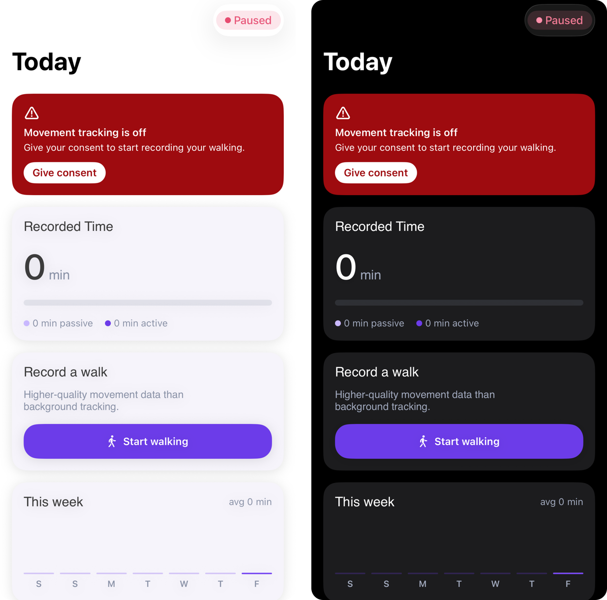

```swift
// MyBrand.swift
import SwiftUI

extension TrackerTheme {
    static var myBrand: TrackerTheme {
        var theme = TrackerTheme.kinetikos
        theme.primary = Color(hex: 0x6C3CE9)
        theme.action = Color(light: 0x3B1E9A, dark: 0xA88BFF)
        theme.passive = Color(hex: 0xC9B8FF)
        theme.screenBackground = Color(light: 0xFFFFFF, dark: 0x000000)
        theme.cardBackground = Color(light: 0xF6F4FB, dark: 0x1C1C1E)
        theme.sectionTitle = Color(light: 0x6B6B78, dark: 0xA88BFF)
        theme.heroGradient = [Color(hex: 0x3B1E9A), Color(hex: 0x1B0C4D)]
        theme.cardRadius = 20
        theme.controlRadius = 20
        theme.titleFont = .custom("Inter-SemiBold", size: 18)
        theme.bodyFont = .custom("Inter-Regular", size: 14)
        return theme
    }
}

// In your App or root view:
//     TrackerTabs()
//         .environment(\.trackerTheme, .myBrand)
```

| Token | Paints |
|---|---|
| `primary` | Buttons, toggles, the walk-test ring at rest, active time in charts, "up to date" |
| `action` | The ring while recording, and status capsules while a session runs |
| `passive` | Background walking in "Recorded Time" |
| `warning`, `error`, `success` | Sync waiting, a discarded walk test or a stop button, a complete About You |
| `alert` | The banner that says nothing is being recorded |
| `screenBackground`, `cardBackground` | Behind the screens, and behind each card and list row |
| `text`, `secondaryText`, `sectionTitle`, `separator` | Text, labels, list headers, the empty ring and outlines |
| `heroGradient` | Behind the Consent screen |
| `cardRadius`, `controlRadius` | Corners of cards, and of buttons and the mode switch |
| fonts | Card titles, body, numbers, the timer |

The wording is yours too: every string is in the template, in English. If your app is localised, wrap them as you do the rest of your app. The Consent Text itself comes from the SDK, in English or Portuguese.

### 9.3 The model

One object follows the SDK for all the templates. Create it once, put it in the environment, and call `follow()` from your root view's `.task` (as `TrackerTabs` does in §9.15).

```swift
// TrackerModel.swift
import SwiftUI
import TrackerSDK

/// What the Tracker screens show, kept up to date from the SDK.
@MainActor @Observable
final class TrackerModel {
    private(set) var status: TrackerStatus?
    private(set) var permissions = Tracker.permissions()
    /// The last seven days, today last.
    private(set) var recordedDays: [TrackerRecordedDay] = []
    /// How the last walk test ended, until another session starts.
    private(set) var walkTestOutcome: TrackerStatus.WalkTestOutcome?

    /// Uploads may use mobile data. Off by default: Wi-Fi only.
    var allowCellular = Tracker.allowCellular {
        didSet { Tracker.setAllowCellular(allowCellular) }
    }

    var motionGranted: Bool {
        permissions.allSatisfy { $0.state == .granted }
    }

    /// Follow the SDK for as long as the calling task runs.
    func follow() async {
        await withDiscardingTaskGroup { group in
            group.addTask { await self.followStatus() }
            group.addTask { await self.followEvents() }
        }
    }

    /// Re-read what may have changed while the app was away: a permission
    /// changed in iOS Settings, a new day.
    func refresh() async {
        permissions = Tracker.permissions()
        recordedDays = await Tracker.recordedTime(days: 7)
    }

    func startWalkTest() async -> Bool {
        walkTestOutcome = nil
        return await Tracker.startWalkTest()
    }

    func startManualRecording() async -> Bool {
        walkTestOutcome = nil
        return await Tracker.startManualRecording()
    }

    private func followStatus() async {
        for await new in Tracker.statusUpdates() {
            let old = status
            status = new
            permissions = Tracker.permissions()
            // A new recording, or one finished: the recorded time moved.
            if old?.sync.pendingCount != new.sync.pendingCount || old?.recording != new.recording {
                recordedDays = await Tracker.recordedTime(days: 7)
            }
        }
    }

    private func followEvents() async {
        for await event in Tracker.events() {
            if case .walkTestFinished(let outcome) = event {
                walkTestOutcome = outcome
            }
        }
    }
}
```

### 9.4 Consent

The Consent Text with its declaration to tick. "I agree" records the Consent, turns tracking on and asks for Motion & Fitness. If the person refuses the permission, the button takes them to iOS Settings, and the screen closes by itself once they turn it on. There's no Decline: closing the screen records nothing.

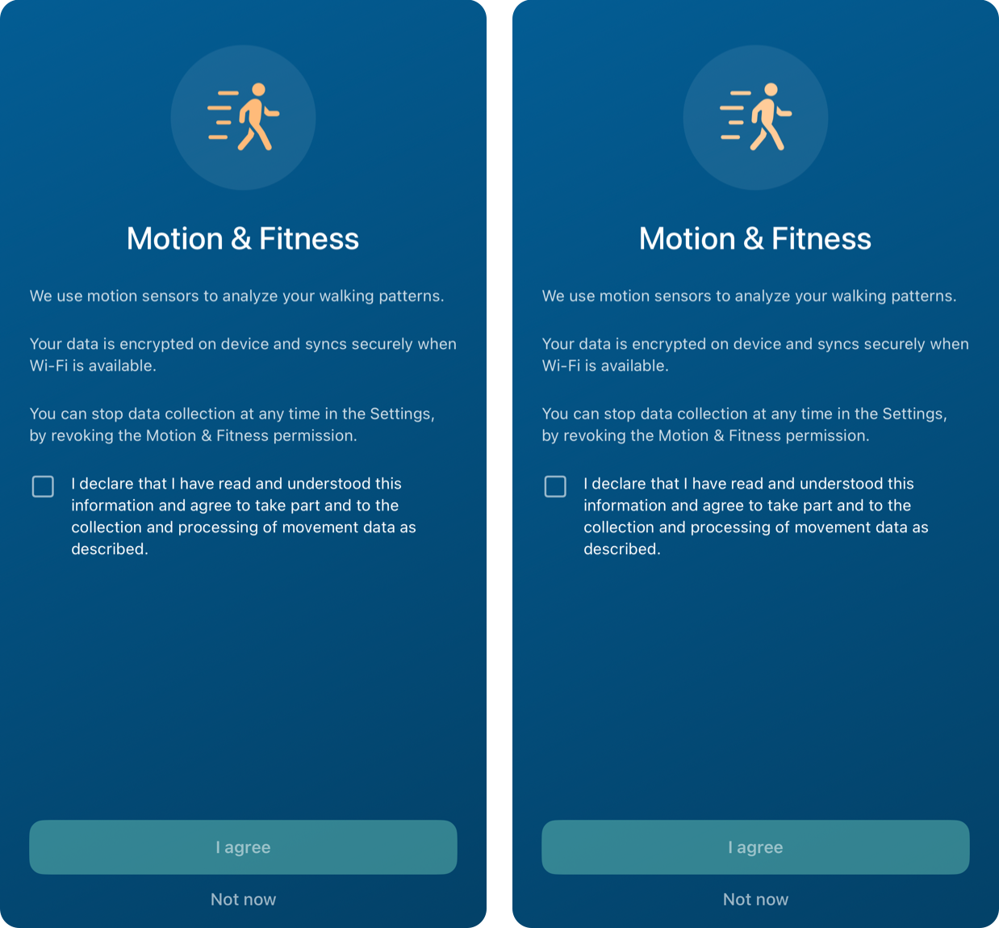

```swift
// TrackerConsentView.swift
import SwiftUI
import TrackerSDK

struct TrackerConsentView: View {
    /// Consent recorded and the permission granted.
    let onDone: () -> Void
    /// Close without consenting; nil hides the button.
    var onNotNow: (() -> Void)?

    @Environment(\.trackerTheme) private var theme
    @Environment(\.scenePhase) private var scenePhase
    @State private var agreed = false
    @State private var saving = false
    @State private var motionDenied = false
    @State private var problem: String?

    private let document = Tracker.consentDocument(
        locale: Locale.current.language.languageCode?.identifier ?? "en"
    )

    var body: some View {
        VStack(spacing: 24) {
            ScrollView {
                VStack(spacing: 24) {
                    Image(systemName: "figure.walk.motion")
                        .font(.system(size: 50))
                        .foregroundStyle(theme.warning)
                        .frame(width: 120, height: 120)
                        .background(.white.opacity(0.08), in: Circle())
                        .padding(.top, 32)

                    Text("Motion & Fitness")
                        .font(.system(size: 26, weight: .medium))

                    ForEach(document.text.components(separatedBy: "\n\n"), id: \.self) { paragraph in
                        Text(paragraph)
                            .font(.footnote)
                            .foregroundStyle(.white.opacity(0.8))
                            .frame(maxWidth: .infinity, alignment: .leading)
                    }

                    Toggle(isOn: $agreed) {
                        Text(document.declaration).font(.footnote)
                    }
                    .toggleStyle(TrackerCheckboxStyle(tint: theme.primary))
                }
            }

            VStack(spacing: 12) {
                if let problem {
                    Text(problem).font(.footnote)
                }
                Button {
                    Task { await agree() }
                } label: {
                    HStack {
                        if saving { ProgressView().tint(.white) }
                        Text(motionDenied ? "Open Settings" : "I agree")
                    }
                }
                .buttonStyle(TrackerButtonStyle())
                .disabled(!agreed || saving)

                if let onNotNow {
                    Button("Not now", action: onNotNow)
                        .font(theme.emphasisFont)
                        .foregroundStyle(.white.opacity(0.6))
                }
            }
            .padding(.bottom, 32)
        }
        .padding(.horizontal, 24)
        .foregroundStyle(.white)
        .background {
            LinearGradient(colors: theme.heroGradient, startPoint: .topLeading, endPoint: .bottomTrailing)
                .ignoresSafeArea()
        }
        .onChange(of: scenePhase) { _, phase in
            // Back from iOS Settings with Motion & Fitness on.
            if phase == .active, motionDenied, Tracker.permissions().allSatisfy({ $0.state == .granted }) {
                onDone()
            }
        }
    }

    private func agree() async {
        if motionDenied {
            openAppSettings()
            return
        }
        saving = true
        defer { saving = false }

        guard await Tracker.giveConsent(version: document.version, locale: document.locale) else {
            // Your tokenProvider returned nil: nobody is signed in.
            problem = "Couldn't record your consent. Make sure you're signed in, then try again."
            return
        }
        // Remembered across launches; records once the permission allows it.
        await Tracker.startTracking()
        if await Tracker.requestPermissions() {
            onDone()
        } else {
            motionDenied = true
            problem = "Motion & Fitness is needed to record your walking. Turn it on in Settings."
        }
    }
}

/// A square checkbox in front of its label.
struct TrackerCheckboxStyle: ToggleStyle {
    let tint: Color

    func makeBody(configuration: Configuration) -> some View {
        Button {
            configuration.isOn.toggle()
        } label: {
            HStack(alignment: .top, spacing: 12) {
                Image(systemName: configuration.isOn ? "checkmark.square.fill" : "square")
                    .font(.title3)
                    .foregroundStyle(configuration.isOn ? tint : .white.opacity(0.6))
                configuration.label
                    .multilineTextAlignment(.leading)
                    .frame(maxWidth: .infinity, alignment: .leading)
            }
        }
        .buttonStyle(.plain)
        .accessibilityAddTraits(configuration.isOn ? .isSelected : [])
    }
}
```

### 9.5 Notice and status capsule

`TrackerNotice` says why nothing is being recorded, with the one thing the person can do about it, and shows nothing while all is well. Put it at the top of your main screen. `TrackerStatusBadge` is a capsule for a header or toolbar.

```swift
// TrackerNotice.swift
import SwiftUI
import TrackerSDK

struct TrackerNotice: View {
    /// Show `TrackerConsentView`.
    let onGiveConsent: () -> Void

    @Environment(TrackerModel.self) private var model
    @Environment(\.trackerTheme) private var theme

    private struct Notice {
        let title: String
        let message: String
        var button: String?
        var action: () -> Void = {}
    }

    var body: some View {
        if let notice {
            VStack(alignment: .leading, spacing: 8) {
                Image(systemName: "exclamationmark.triangle")
                    .font(.system(size: 18, weight: .semibold))
                    .accessibilityHidden(true)

                VStack(alignment: .leading, spacing: 4) {
                    Text(notice.title).font(theme.emphasisFont.weight(.semibold))
                    Text(notice.message).font(theme.captionFont)
                }
                .accessibilityElement(children: .combine)

                if let button = notice.button {
                    Button(action: notice.action) {
                        Text(button)
                            .font(theme.emphasisFont.weight(.semibold))
                            .foregroundStyle(theme.alert)
                            .padding(.horizontal, 12)
                            .padding(.vertical, 6)
                            .background(.white, in: Capsule())
                    }
                    .buttonStyle(.plain)
                    .padding(.top, 4)
                }
            }
            .foregroundStyle(.white)
            .frame(maxWidth: .infinity, alignment: .leading)
            .padding(16)
            .background(theme.alert, in: RoundedRectangle(cornerRadius: theme.cardRadius))
        }
    }

    private var notice: Notice? {
        switch model.status?.state {
        case .needsConsent:
            return Notice(title: "Movement tracking is off",
                          message: "Give your consent to start recording your walking.",
                          button: "Give consent", action: onGiveConsent)
        case .withdrawn:
            return Notice(title: "Movement tracking is paused",
                          message: "You withdrew your consent. Movement is not recorded until you give it again.",
                          button: "Give consent again", action: onGiveConsent)
        case .needsPermissions:
            if model.permissions.contains(where: { $0.state == .notDetermined }) {
                return Notice(title: "Movement tracking is paused",
                              message: "Allow Motion & Fitness so your walking can be recorded.",
                              button: "Allow", action: { Task { await Tracker.requestPermissions() } })
            }
            return Notice(title: "Movement tracking is paused",
                          message: "Motion & Fitness is off for this app, so walking isn't recorded. Turn it on in Settings.",
                          button: "Open Settings", action: openAppSettings)
        case .studyInactive:
            return Notice(title: "The study isn't active at the moment",
                          message: "Walking isn't recorded until it resumes. There's nothing you need to do.")
        case .revoked:
            return Notice(title: "You're no longer taking part",
                          message: "Your walking isn't recorded any more.")
        default:
            return nil
        }
    }
}

/// What is recording right now, as a capsule.
struct TrackerStatusBadge: View {
    @Environment(TrackerModel.self) private var model
    @Environment(\.trackerTheme) private var theme

    var body: some View {
        let label = self.label
        TrackerCapsule(text: label.text, color: label.color)
    }

    private var label: (text: String, color: Color) {
        guard let status = model.status else { return ("…", theme.secondaryText) }
        if status.recording.walkTest { return ("Walk test", theme.action) }
        if status.recording.manual { return ("Recording a walk", theme.action) }
        switch status.state {
        case .active: return ("Tracking walks", theme.primary)
        case .stopped: return ("Tracking off", theme.secondaryText)
        case .signedOut, .notConfigured: return ("Signed out", theme.secondaryText)
        default: return ("Paused", theme.error)
        }
    }
}
```

### 9.6 Today's activity and this week

`RecordedTodayCard` shows today's recorded walking, split into background tracking and recorded walks or walk tests. `RecordWalkCard` leads to the walk screen. `RecordedWeekCard` shows the last seven days, with today highlighted. It needs nothing but the SDK; `WalkingWeekCard` (§9.14) is the same card with Kinetikos' walking time.

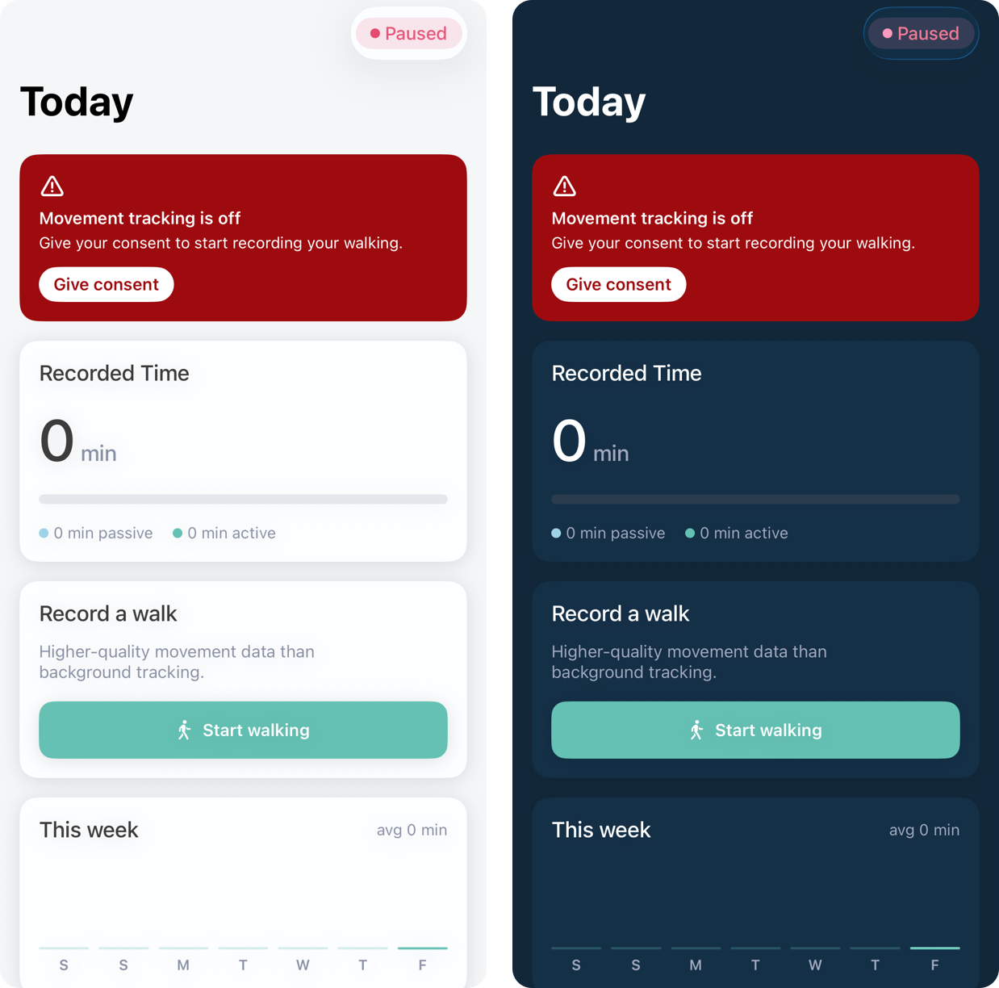

```swift
// TodayCards.swift
import SwiftUI
import TrackerSDK

struct RecordedTodayCard: View {
    @Environment(TrackerModel.self) private var model
    @Environment(\.trackerTheme) private var theme

    var body: some View {
        let today = model.recordedDays.last
        let total = minutes(today?.totalSeconds ?? 0)
        let active = minutes(today?.activeSeconds ?? 0)

        VStack(alignment: .leading, spacing: 16) {
            Text("Recorded Time").font(theme.titleFont)

            HStack(alignment: .firstTextBaseline, spacing: 4) {
                Text("\(total)").font(theme.numberFont)
                Text("min").font(theme.titleFont).foregroundStyle(theme.secondaryText)
            }

            SplitBar(passive: today?.passiveSeconds ?? 0, active: today?.activeSeconds ?? 0)
                .frame(height: 8)

            HStack(spacing: 16) {
                legend(theme.passive, "\(max(0, total - active)) min passive")
                legend(theme.primary, "\(active) min active")
            }
        }
        .foregroundStyle(theme.text)
        .trackerCard()
    }

    private func legend(_ color: Color, _ text: String) -> some View {
        HStack(spacing: 4) {
            Circle().fill(color).frame(width: 8, height: 8)
            Text(text).font(theme.captionFont).foregroundStyle(theme.secondaryText)
        }
    }
}

/// Background and active time side by side, in proportion.
private struct SplitBar: View {
    let passive: Int
    let active: Int
    @Environment(\.trackerTheme) private var theme

    var body: some View {
        GeometryReader { geo in
            let total = CGFloat(max(passive + active, 1))
            ZStack(alignment: .leading) {
                Capsule().fill(theme.separator.opacity(0.4))
                HStack(spacing: passive > 0 && active > 0 ? 2 : 0) {
                    if passive > 0 {
                        Capsule().fill(theme.passive)
                            .frame(width: max(geo.size.width * CGFloat(passive) / total - 1, 0))
                    }
                    if active > 0 {
                        Capsule().fill(theme.primary)
                            .frame(width: max(geo.size.width * CGFloat(active) / total - 1, 0))
                    }
                }
            }
        }
    }
}

struct RecordWalkCard: View {
    let onStartWalking: () -> Void
    @Environment(\.trackerTheme) private var theme

    var body: some View {
        VStack(alignment: .leading, spacing: 12) {
            Text("Record a walk").font(theme.titleFont)
            Text("Higher-quality movement data than background tracking.")
                .font(theme.bodyFont)
                .foregroundStyle(theme.secondaryText)
            Button(action: onStartWalking) {
                Label("Start walking", systemImage: "figure.walk")
            }
            .buttonStyle(TrackerButtonStyle())
            .padding(.top, 4)
        }
        .foregroundStyle(theme.text)
        .trackerCard()
    }
}

struct RecordedWeekCard: View {
    @Environment(TrackerModel.self) private var model
    @Environment(\.trackerTheme) private var theme

    private let plotHeight: CGFloat = 72

    var body: some View {
        let days = model.recordedDays
        let longest = CGFloat(max(days.map(\.totalSeconds).max() ?? 0, 1))
        let average = days.isEmpty ? 0 : minutes(days.map(\.totalSeconds).reduce(0, +) / days.count)

        VStack(alignment: .leading, spacing: 16) {
            HStack {
                Text("This week").font(theme.titleFont)
                Spacer()
                Text("avg \(average) min").font(theme.captionFont).foregroundStyle(theme.secondaryText)
            }

            HStack(alignment: .bottom, spacing: 8) {
                ForEach(days, id: \.day) { day in
                    let isToday = Calendar.current.isDateInToday(day.day)
                    VStack(spacing: 4) {
                        Spacer(minLength: 0)
                        RoundedRectangle(cornerRadius: 4)
                            .fill(isToday ? AnyShapeStyle(theme.primary.gradient) : AnyShapeStyle(theme.primary.opacity(0.25)))
                            .frame(height: max(2, plotHeight * CGFloat(day.totalSeconds) / longest))
                        Text(day.day.formatted(.dateTime.weekday(.narrow)))
                            .font(.system(size: 12, weight: .semibold))
                            .foregroundStyle(theme.secondaryText)
                            .frame(height: 18)
                    }
                    .frame(maxWidth: .infinity)
                    .accessibilityElement(children: .ignore)
                    .accessibilityLabel("\(day.day.formatted(.dateTime.weekday(.wide))), \(minutes(day.totalSeconds)) minutes")
                }
            }
            .frame(height: plotHeight + 22)
        }
        .foregroundStyle(theme.text)
        .trackerCard()
    }
}

private func minutes(_ seconds: Int) -> Int {
    Int((Double(seconds) / 60).rounded())
}
```

### 9.7 Walk screen

A switch between the 6-minute walk test and a free walk, a ring that counts down the test (or up, for a free walk), and one start/stop button. Stopping a test early asks first, because the test is then discarded. After a test, the screen says how it ended. Coming back to the screen mid-walk shows the session that is running.

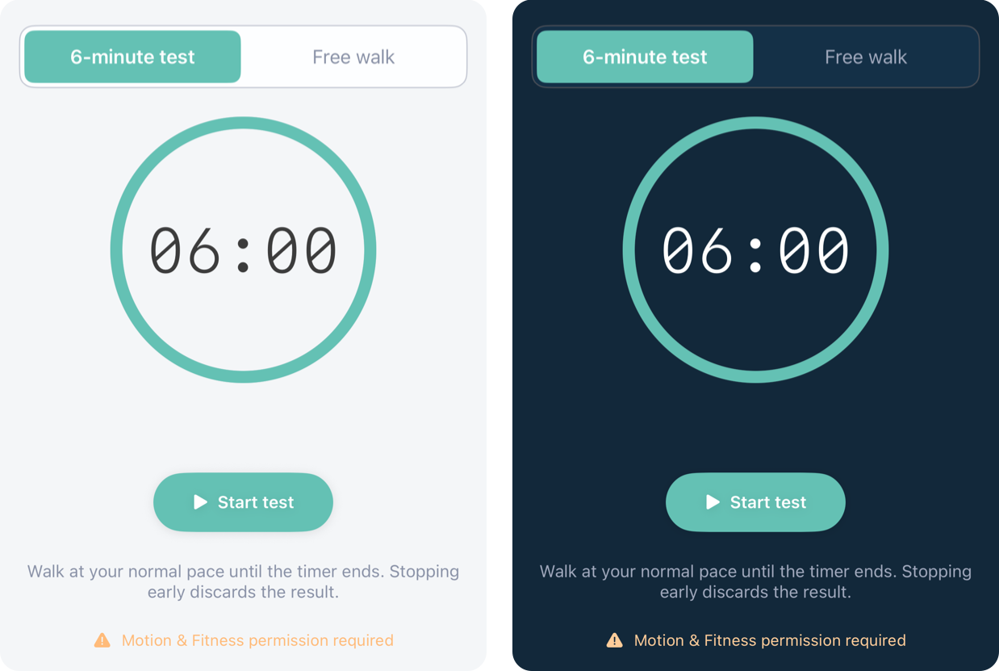

```swift
// WalkSessionView.swift
import SwiftUI
import TrackerSDK

struct WalkSessionView: View {
    /// Lock the test, e.g. until About You is complete (§9.11). The button still
    /// works and calls `onLockedTap`, so the person finds out why.
    var walkTestLocked = false
    var onLockedTap: () -> Void = {}

    @Environment(TrackerModel.self) private var model
    @Environment(\.trackerTheme) private var theme
    @State private var testMode = true
    @State private var confirmStop = false
    @State private var couldNotStart = false

    private var recording: TrackerStatus.Recording? { model.status?.recording }
    private var running: Bool { recording.map { $0.manual || $0.walkTest } ?? false }
    private var runningTest: Bool { recording?.walkTest ?? false }

    var body: some View {
        ScrollView {
            VStack(spacing: 24) {
                ModeSwitch(testMode: $testMode)
                    .disabled(running)

                TimelineView(.periodic(from: .now, by: 1)) { context in
                    ring(at: context.date)
                }

                statusArea
                sessionButton

                Text(testMode
                     ? "Walk at your normal pace until the timer ends. Stopping early discards the result."
                     : "Walk for as long as you like. The session is saved when you stop.")
                    .font(theme.bodyFont)
                    .foregroundStyle(theme.secondaryText)
                    .multilineTextAlignment(.center)

                if testMode && !running && walkTestLocked {
                    Text("Locked until you fill in About You.")
                        .font(theme.captionFont)
                        .foregroundStyle(theme.error)
                }
                if !model.motionGranted {
                    Label("Motion & Fitness permission required", systemImage: "exclamationmark.triangle.fill")
                        .font(theme.captionFont)
                        .foregroundStyle(theme.warning)
                }
            }
            .padding(16)
            .frame(maxWidth: .infinity)
        }
        .background(theme.screenBackground)
        .onAppear(perform: showRunningSession)
        .onChange(of: running) { showRunningSession() }
        .onChange(of: runningTest) { showRunningSession() }
        .alert("Stop the test?", isPresented: $confirmStop) {
            Button("Stop test", role: .destructive) { Task { await Tracker.stopWalkTest() } }
            Button("Keep walking", role: .cancel) {}
        } message: {
            Text("The six minutes are not up yet. Stopping now discards this recording: nothing is saved.")
        }
        .alert("Couldn't start", isPresented: $couldNotStart) {
            Button("OK", role: .cancel) {}
        } message: {
            Text("Check that you've given your consent and that Motion & Fitness is on.")
        }
    }

    // MARK: Ring

    private func ring(at now: Date) -> some View {
        let duration = Tracker.walkTestDurationSeconds
        let elapsed = recording?.sessionStartedAt.map { max(0, Int(now.timeIntervalSince($0))) } ?? 0
        let remaining = max(0, duration - elapsed)
        let completed = !running && testMode && model.walkTestOutcome == .completed

        let seconds: Int
        if running {
            seconds = runningTest ? remaining : elapsed
        } else {
            seconds = testMode && !completed ? duration : 0
        }
        let progress = running && runningTest ? Double(remaining) / Double(duration) : 1

        return CountdownRing(
            progress: progress,
            color: running ? theme.action : theme.primary,
            halo: completed,
            animated: running
        ) {
            TimerText(seconds: seconds)
        }
    }

    // MARK: Status

    private var statusArea: some View {
        ZStack {
            // Holds the height, so the ring doesn't move when a status appears.
            TrackerCapsule(text: "Recording", color: theme.primary).hidden()

            if running {
                TrackerCapsule(text: runningTest ? "6-Minute Walk Test" : "Recording", color: theme.primary)
            } else if testMode, let outcome = model.walkTestOutcome {
                if outcome == .completed {
                    VStack(spacing: 8) {
                        TrackerCapsule(text: "Finished 6-Minute Walk", color: theme.primary)
                        Text("Your result appears a few minutes after the recording is uploaded.")
                            .font(theme.captionFont)
                            .foregroundStyle(theme.secondaryText)
                            .multilineTextAlignment(.center)
                    }
                } else {
                    Text(Self.discarded(outcome))
                        .font(theme.emphasisFont)
                        .foregroundStyle(theme.error)
                        .multilineTextAlignment(.center)
                }
            }
        }
    }

    private static func discarded(_ outcome: TrackerStatus.WalkTestOutcome) -> String {
        switch outcome {
        case .stoppedMoving: return "Test stopped because no movement was detected. It was not saved."
        case .stoppedEarly: return "Test stopped before six minutes. It was not saved."
        default: return "Test stopped because of an error. It was not saved."
        }
    }

    // MARK: Button

    private var sessionButton: some View {
        let label = running
            ? (runningTest ? "Stop test" : "Stop walk")
            : (testMode ? "Start test" : "Start walk")
        return Button(action: startOrStop) {
            Label(label, systemImage: running ? "stop.fill" : "play.fill")
                .font(theme.buttonFont)
                .foregroundStyle(.white)
                .padding(.horizontal, 32)
                .padding(.vertical, 16)
                .background(running ? theme.error : theme.primary, in: Capsule())
                .shadow(color: .black.opacity(0.1), radius: 4, y: 1)
        }
        .buttonStyle(.plain)
    }

    private func startOrStop() {
        if running {
            if runningTest {
                confirmStop = true
            } else {
                Task { await Tracker.stopManualRecording() }
            }
        } else if testMode && walkTestLocked {
            onLockedTap()
        } else {
            Task {
                let started: Bool
                if testMode {
                    started = await model.startWalkTest()
                } else {
                    started = await model.startManualRecording()
                }
                couldNotStart = !started
            }
        }
    }

    /// The session already running decides the mode.
    private func showRunningSession() {
        if running { testMode = runningTest }
    }
}

private struct ModeSwitch: View {
    @Binding var testMode: Bool
    @Environment(\.trackerTheme) private var theme
    @Environment(\.isEnabled) private var isEnabled

    var body: some View {
        HStack(spacing: 4) {
            segment("6-minute test", selected: testMode) { testMode = true }
            segment("Free walk", selected: !testMode) { testMode = false }
        }
        .padding(4)
        .background(theme.cardBackground, in: RoundedRectangle(cornerRadius: theme.controlRadius))
        .overlay {
            RoundedRectangle(cornerRadius: theme.controlRadius).stroke(theme.separator, lineWidth: 1)
        }
    }

    private func segment(_ title: String, selected: Bool, action: @escaping () -> Void) -> some View {
        Button(action: action) {
            Text(title)
                .font(.system(size: 16, weight: selected ? .semibold : .regular))
                .foregroundStyle(selected ? .white : theme.secondaryText)
                .opacity(isEnabled ? 1 : 0.5)
                .frame(maxWidth: .infinity)
                .padding(.vertical, 12)
                .background(selected ? theme.primary : .clear, in: RoundedRectangle(cornerRadius: theme.controlRadius - 4))
                .contentShape(Rectangle())
        }
        .buttonStyle(.plain)
        .accessibilityAddTraits(selected ? .isSelected : [])
    }
}

/// Drains counter-clockwise from twelve o'clock as the test runs. A completed
/// test gains a halo, which tells it apart from the full ring at rest.
private struct CountdownRing<Content: View>: View {
    let progress: Double
    let color: Color
    let halo: Bool
    let animated: Bool
    @ViewBuilder let content: () -> Content

    @Environment(\.trackerTheme) private var theme
    private let size: CGFloat = 220
    private let stroke: CGFloat = 10

    var body: some View {
        ZStack {
            if halo {
                Circle().stroke(color.opacity(0.25), lineWidth: stroke * 2.4).padding(stroke / 2)
            }
            Circle().stroke(theme.separator, lineWidth: stroke).padding(stroke / 2)
            Circle()
                .trim(from: 0, to: progress)
                .stroke(color, style: StrokeStyle(lineWidth: stroke, lineCap: .round))
                .rotationEffect(.degrees(-90))
                .scaleEffect(x: -1, y: 1)
                .padding(stroke / 2)
                .animation(animated ? .linear(duration: 1) : nil, value: progress)
            content()
        }
        .frame(width: size, height: size)
    }
}

private struct TimerText: View {
    let seconds: Int
    @Environment(\.trackerTheme) private var theme

    var body: some View {
        let hours = seconds / 3600
        let minutes = seconds % 3600 / 60
        let secs = seconds % 60
        Text(hours > 0
             ? String(format: "%02d:%02d:%02d", hours, minutes, secs)
             : String(format: "%02d:%02d", minutes, secs))
            .font(theme.timerFont)
            .monospacedDigit()
            .lineLimit(1)
            .minimumScaleFactor(0.7)
            .foregroundStyle(theme.text)
    }
}
```

### 9.8 Settings

Four `Section`s for a settings `List`: cloud sync, permissions, consent and sign-out, and a diagnostics report for your support team.

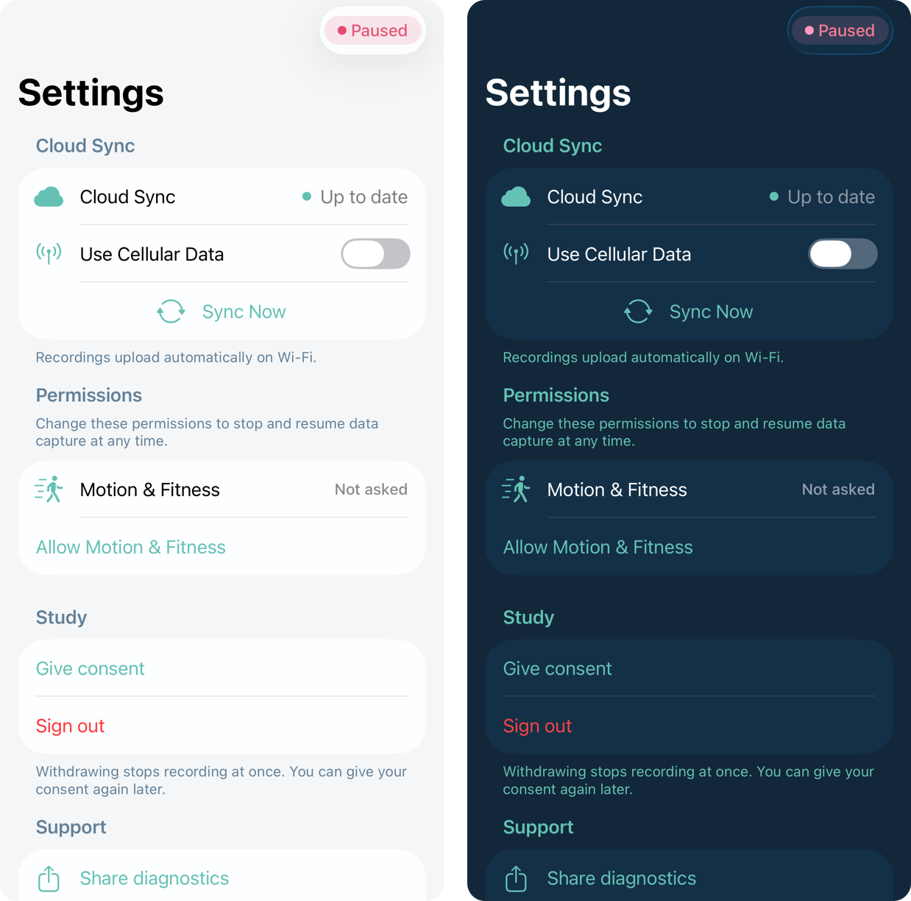

```swift
// SettingsSections.swift
import SwiftUI
import TrackerSDK

struct CloudSyncSection: View {
    @Environment(TrackerModel.self) private var model
    @Environment(\.trackerTheme) private var theme
    @State private var syncing = false

    var body: some View {
        @Bindable var model = model
        Section {
            HStack {
                Label("Cloud Sync", systemImage: "icloud.fill")
                Spacer()
                Circle().fill(state.color).frame(width: 8, height: 8)
                Text(state.text).foregroundStyle(.secondary)
            }

            Toggle(isOn: $model.allowCellular) {
                Label("Use Cellular Data", systemImage: "antenna.radiowaves.left.and.right")
            }
            .tint(theme.primary)

            Button {
                Task {
                    syncing = true
                    await Tracker.syncNow()
                    syncing = false
                }
            } label: {
                HStack {
                    Spacer()
                    if syncing {
                        ProgressView()
                        Text("Syncing…")
                    } else {
                        Label("Sync Now", systemImage: "arrow.triangle.2.circlepath")
                    }
                    Spacer()
                }
            }
            .disabled(syncing)
        } header: {
            Text("Cloud Sync").foregroundStyle(theme.sectionTitle)
        } footer: {
            Text(footer).foregroundStyle(theme.sectionTitle)
        }
        .listRowBackground(theme.cardBackground)
    }

    private var state: (text: String, color: Color) {
        guard let sync = model.status?.sync else { return ("…", theme.secondaryText) }
        if sync.pendingCount == 0 { return ("Up to date", theme.primary) }
        if syncing || sync.uploadingCount > 0 { return ("Uploading \(sync.pendingCount)…", theme.primary) }
        switch sync.waitingFor {
        case .network?: return ("Offline", theme.secondaryText)
        case .wifi?: return ("Waiting for Wi-Fi", theme.warning)
        case .lowDataMode?: return ("Low Data Mode is on", theme.warning)
        case nil: return ("\(sync.pendingCount) pending", theme.warning)
        default: return ("Checking consent", theme.warning)
        }
    }

    private var footer: String {
        var text = model.allowCellular
            ? "Recordings upload automatically over any network."
            : "Recordings upload automatically on Wi-Fi."
        if let last = model.status?.sync.lastSyncedAt {
            text += " Last upload \(last.formatted(.relative(presentation: .named)))."
        }
        return text
    }
}

struct TrackerPermissionsSection: View {
    @Environment(TrackerModel.self) private var model
    @Environment(\.trackerTheme) private var theme

    private var motion: TrackerPermission.State? {
        model.permissions.first { $0.kind == .motion }?.state
    }

    var body: some View {
        Section {
            HStack {
                Label("Motion & Fitness", systemImage: "figure.walk.motion")
                Spacer()
                Text(motionText)
                    .font(theme.emphasisFont)
                    .foregroundStyle(motion == .granted ? theme.primary : motion == .denied ? theme.error : .secondary)
            }
            if motion == .notDetermined {
                Button("Allow Motion & Fitness") {
                    Task { await Tracker.requestPermissions() }
                }
            } else if motion == .denied {
                Button("Open Settings", action: openAppSettings)
            }
            if let backgroundNote {
                Label(backgroundNote, systemImage: "exclamationmark.triangle")
                    .font(theme.captionFont)
                    .foregroundStyle(theme.warning)
            }
        } header: {
            VStack(alignment: .leading, spacing: 8) {
                Text("Permissions")
                Text("Change these permissions to stop and resume data capture at any time.")
                    .font(theme.captionFont)
                    .textCase(nil)
            }
            .foregroundStyle(theme.sectionTitle)
        }
        .listRowBackground(theme.cardBackground)
    }

    private var motionText: String {
        switch motion {
        case .granted?: return "Allowed"
        case .denied?: return "Not allowed"
        default: return "Not asked"
        }
    }

    /// Not required, but without it walks are collected only when the app opens.
    private var backgroundNote: String? {
        switch model.status?.backgroundRefresh {
        case .off?: return "Background App Refresh is off: walks are collected when you open the app."
        case .restricted?: return "Low Power Mode limits background work: walks are collected when you open the app."
        default: return nil
        }
    }
}

struct ParticipationSection: View {
    /// Show `TrackerConsentView`.
    let onGiveConsent: () -> Void
    /// Your own sign-out. `Tracker.signOut()` runs first, so a last upload can
    /// still get a token (§5.8).
    let onSignOut: () async -> Void

    @Environment(TrackerModel.self) private var model
    @Environment(\.trackerTheme) private var theme
    @State private var confirmWithdraw = false
    @State private var confirmSignOut = false

    var body: some View {
        Section {
            if model.status?.state == .needsConsent || model.status?.state == .withdrawn {
                Button("Give consent", action: onGiveConsent)
            } else {
                Button("Withdraw consent", role: .destructive) { confirmWithdraw = true }
            }
            Button("Sign out", role: .destructive) { confirmSignOut = true }
        } header: {
            Text("Study").foregroundStyle(theme.sectionTitle)
        } footer: {
            Text("Withdrawing stops recording at once. You can give your consent again later.")
                .foregroundStyle(theme.sectionTitle)
        }
        .listRowBackground(theme.cardBackground)
        .alert("Withdraw consent?", isPresented: $confirmWithdraw) {
            Button("Withdraw", role: .destructive) { Task { await Tracker.withdrawConsent() } }
            Button("Cancel", role: .cancel) {}
        } message: {
            Text("Your walking stops being recorded, and anything recorded from now on is deleted without being sent.")
        }
        .alert("Sign out?", isPresented: $confirmSignOut) {
            Button("Sign out", role: .destructive) {
                Task {
                    await Tracker.signOut()
                    await onSignOut()
                }
            }
            Button("Cancel", role: .cancel) {}
        }
    }
}

/// A plain-text report of what the SDK is doing on this phone, for a support
/// ticket. It holds no tokens, no ids of yours and no sensor data.
struct TrackerSupportSection: View {
    @Environment(\.trackerTheme) private var theme
    @State private var report: String?

    var body: some View {
        Section {
            if let report {
                ShareLink(item: report) {
                    Label("Share diagnostics", systemImage: "square.and.arrow.up")
                }
            } else {
                ProgressView()
            }
            LabeledContent("Tracker SDK", value: Tracker.sdkVersion)
        } header: {
            Text("Support").foregroundStyle(theme.sectionTitle)
        }
        .listRowBackground(theme.cardBackground)
        .task { report = await Tracker.diagnostics().description }
    }
}
```

### 9.9 The Kinetikos API

What Kinetikos makes of the recordings, the SDK doesn't return: your app reads it from Kinetikos directly, with the same participant token the SDK uses (your `tokenProvider`, §5.2):

| Endpoint | What |
|---|---|
| `GET /v1/walk-tests?limit=20&offset=0` | The participant's 6-minute walk-test results, `{ "tests": [ … ] }` |
| `GET /v1/profile/demographics` | About You: date of birth, gender at birth, height, weight |
| `PUT /v1/profile/demographics` | Change any of them; a field sent as `null` is cleared, one left out is kept |
| `GET /v1/viz?tz=Europe/Lisbon` | Gait Vitals for yesterday, and the usual walking pattern by hour and by weekday |
| `GET /v1/stats/minutes/daily?tz=Europe/Lisbon` | The last seven days, today last: minutes recorded, and how much of them was walking |

Send the phone's own time zone as `tz`: it decides which day is yesterday, and which day each recording falls in. `KinetikosAPI` does.

**Walk-test results.** A completed test's row appears once its recording is uploaded, usually within minutes. Kinetikos may refine its figures later. `step_distance` is the distance walked in metres, `velocity` the average speed in m/s, and `mets` the effort in METs. `notes` is empty for a clean test. Otherwise it flags a problem: `INVALID` means don't show the figures; `NO_DATA` means nothing usable, so leave the row out; anything else (`CHECK`, `short_test`, …) means the result is doubtful and the person should repeat the test.

**About You.** Kinetikos uses date of birth, gender at birth, height and weight to work out walk-test effort, and uses population averages for what is missing. The backend accepts `gender_at_birth` as `male`, `female`, `intersex` or `prefer_not_to_say`, height from 50 to 260 cm, weight from 10 to 400 kg, and a date of birth in the past, as `yyyy-MM-dd`. The tracKer app asks for all four before the walk test; whether you do is up to you.

**Gait Vitals.** Each night Kinetikos compares the day's walking with the person's usual range: the median and spread of up to the previous 90 days. `gait_vitals.vitals` has one point per metric with enough history: the day's `value`, the usual `med`, and `z`, how far from usual (clamped to ±3). `status` is `typical` within one spread of usual, `mild` up to two, and `outlier` beyond. `summary` counts them. With no walking that day, `vitals` is empty and `summary` null. `daily_pattern` and `weekly_pattern` hold the usual value of each metric for each hour of the day (24, midnight first) and each day of the week (7, Monday first); `null` where there's no walking to go by. The metrics are duration (minutes), steps, distance (metres), speed (m/s) and vigour (MET-minutes, shown as Effort).

**Walking time.** Every day of the window is there, with zeros for a day with nothing recorded. `total_minutes` is everything recorded: background tracking, recorded walks and walk tests. `processed` is what Kinetikos found in the day's background tracking: `walking_minutes`, and a `status` of `processed` (all analysed), `partial` (some; the figure can grow), `pending` (uploaded, none analysed yet: `walking_minutes` is `null`), `no_data` (nothing recorded) or `failed` (some recordings couldn't be analysed). It's missing while Kinetikos has no analysis for the participant yet; show recorded time then.

```swift
// KinetikosAPI.swift
import Foundation

enum KinetikosAPI {
    /// The same environment as `Tracker.configure` (§1).
    static let host = URL(string: "https://tracker-api.kinetikos.io")!

    static func walkTests(limit: Int = 20) async throws -> [WalkTestResult] {
        let page: WalkTestPage = try await send("GET", "v1/walk-tests", query: [URLQueryItem(name: "limit", value: "\(limit)")])
        return page.tests
    }

    static func demographics() async throws -> Demographics {
        try await send("GET", "v1/profile/demographics")
    }

    static func saveDemographics(_ demographics: Demographics) async throws -> Demographics {
        let encoder = JSONEncoder()
        encoder.keyEncodingStrategy = .convertToSnakeCase
        return try await send("PUT", "v1/profile/demographics", body: encoder.encode(demographics))
    }

    /// Gait Vitals for yesterday in `timeZone`, and the usual walking pattern.
    static func gaitVitals(timeZone: TimeZone = .current) async throws -> GaitVitalsReport {
        try await send("GET", "v1/viz", query: [URLQueryItem(name: "tz", value: timeZone.identifier)])
    }

    /// The last seven days in `timeZone`, today last.
    static func walkingWeek(timeZone: TimeZone = .current) async throws -> WalkingWeek {
        try await send("GET", "v1/stats/minutes/daily", query: [URLQueryItem(name: "tz", value: timeZone.identifier)])
    }

    private static func send<T: Decodable>(
        _ method: String, _ path: String, query: [URLQueryItem] = [], body: Data? = nil
    ) async throws -> T {
        var url = host.appending(path: path)
        if !query.isEmpty { url.append(queryItems: query) }
        var request = URLRequest(url: url)
        request.httpMethod = method
        if let body {
            request.httpBody = body
            request.setValue("application/json", forHTTPHeaderField: "Content-Type")
        }
        // A refused token (401, e.g. expired) is retried once with a new one, as the SDK does.
        for forceRefresh in [false, true] {
            guard let token = try await ParticipantTokens.fetch(forceRefresh: forceRefresh) else {
                throw KinetikosAPIError.signedOut
            }
            request.setValue("Bearer \(token)", forHTTPHeaderField: "Authorization")
            let (data, response) = try await URLSession.shared.data(for: request)
            let status = (response as? HTTPURLResponse)?.statusCode ?? 0
            if status == 401 && !forceRefresh { continue }
            guard (200..<300).contains(status) else { throw KinetikosAPIError.status(status) }
            let decoder = JSONDecoder()
            decoder.keyDecodingStrategy = .convertFromSnakeCase
            return try decoder.decode(T.self, from: data)
        }
        throw KinetikosAPIError.status(401)
    }
}

enum KinetikosAPIError: Error {
    /// Your tokenProvider returned nil.
    case signedOut
    case status(Int)
}

/// One 6-minute walk test, as Kinetikos measured it.
struct WalkTestResult: Decodable, Identifiable, Sendable {
    let id: String
    /// The day of the test in the phone's time zone, "yyyy-MM-dd".
    let dateRef: String?
    /// Metres walked.
    let stepDistance: Double?
    /// Average speed, m/s.
    let velocity: Double?
    /// Effort, in METs.
    let mets: Double?
    /// Empty for a clean test.
    let notes: String?

    enum Flag { case invalid, noData, doubtful }

    var flag: Flag? {
        switch notes?.trimmingCharacters(in: .whitespacesAndNewlines).uppercased() {
        case nil, "": return nil
        case "INVALID": return .invalid
        case "NO_DATA": return .noData
        default: return .doubtful
        }
    }

    var day: Date? { dateRef.flatMap(kinetikosDay) }
}

struct WalkTestPage: Decodable, Sendable {
    let tests: [WalkTestResult]
}

/// About You. A field left nil isn't sent, so it isn't changed.
struct Demographics: Codable, Sendable, Equatable {
    /// "yyyy-MM-dd".
    var dateOfBirth: String?
    /// male, female, intersex or prefer_not_to_say.
    var genderAtBirth: String?
    var heightCm: Double?
    var weightKg: Double?

    var isComplete: Bool {
        dateOfBirth != nil && genderAtBirth != nil && heightCm != nil && weightKg != nil
    }
}

/// What Gait Vitals measure, by the names Kinetikos sends.
enum GaitMetric: String, Decodable, CaseIterable, Identifiable, Sendable {
    case duration, steps, distance, speed, vigour

    var id: Self { self }

    var title: String {
        switch self {
        case .duration: "Duration"
        case .steps: "Steps"
        case .distance: "Distance"
        case .speed: "Speed"
        case .vigour: "Effort"
        }
    }

    var unit: String {
        switch self {
        case .duration: "min"
        case .steps: "steps"
        case .distance: "m"
        case .speed: "m/s"
        case .vigour: "MET-min"
        }
    }

    /// An SF Symbol.
    var symbol: String {
        switch self {
        case .duration: "clock.fill"
        case .steps: "figure.walk"
        case .distance: "point.topleft.down.to.point.bottomright.curvepath.fill"
        case .speed: "gauge.with.dots.needle.67percent"
        case .vigour: "flame.fill"
        }
    }

    /// A value as the cards print it, without the unit.
    func formatted(_ value: Double) -> String {
        switch self {
        case .speed: value.formatted(.number.precision(.fractionLength(2)))
        case .vigour: value.formatted(.number.precision(.fractionLength(1)))
        case .duration, .steps, .distance: value.formatted(.number.precision(.fractionLength(0)))
        }
    }
}

/// Gait Vitals and the usual walking pattern.
struct GaitVitalsReport: Decodable, Sendable {
    /// The day the vitals describe: yesterday, "yyyy-MM-dd".
    let date: String
    let gaitVitals: GaitVitals
    /// The usual value in each hour of the day, midnight first.
    let dailyPattern: MetricSlots
    /// The usual value on each day of the week, Monday first.
    let weeklyPattern: MetricSlots

    var day: Date? { kinetikosDay(date) }

    /// Whether either pattern has anything to show.
    var hasPattern: Bool {
        GaitMetric.allCases.contains { dailyPattern.hasData($0) || weeklyPattern.hasData($0) }
    }
}

struct GaitVitals: Decodable, Sendable {
    /// One point per metric with enough history; empty with no walking that day.
    let vitals: [Vital]
    /// Nil when `vitals` is empty.
    let summary: Summary?

    struct Vital: Decodable, Identifiable, Sendable {
        let metric: GaitMetric
        /// The day's value, in the metric's unit.
        let value: Double
        /// The usual value.
        let med: Double
        /// How far from usual, from -3 to 3.
        let z: Double
        /// typical, mild or outlier.
        let status: String?

        var id: GaitMetric { metric }

        /// Kinetikos' verdict; worked out from `z` only if it sent none.
        var level: Level {
            switch status {
            case "typical": .typical
            case "mild": .mild
            case "outlier": .outlier
            default: abs(z) < 1 ? .typical : abs(z) < 2 ? .mild : .outlier
            }
        }
    }

    enum Level: Sendable {
        case typical, mild, outlier
    }

    struct Summary: Decodable, Sendable {
        /// Metrics that aren't outliers, out of `total`.
        let within: Int
        let total: Int
        /// The outliers above and below the usual range.
        let above: [GaitMetric]
        let below: [GaitMetric]
    }
}

/// One value per slot for each metric; nil where there's nothing to go by.
struct MetricSlots: Decodable, Sendable {
    let duration: [Double?]
    let steps: [Double?]
    let distance: [Double?]
    let speed: [Double?]
    let vigour: [Double?]

    subscript(metric: GaitMetric) -> [Double?] {
        switch metric {
        case .duration: duration
        case .steps: steps
        case .distance: distance
        case .speed: speed
        case .vigour: vigour
        }
    }

    func hasData(_ metric: GaitMetric) -> Bool {
        self[metric].contains { ($0 ?? 0) > 0 }
    }
}

/// The last seven days, oldest first.
struct WalkingWeek: Decodable, Sendable {
    let days: [Day]

    /// Whether Kinetikos sent walking time. Without it, show recorded time.
    var hasWalkingTime: Bool { days.contains { $0.processed != nil } }

    struct Day: Decodable, Sendable {
        /// "yyyy-MM-dd" in the time zone asked for.
        let date: String
        /// Everything recorded: background tracking, recorded walks and walk tests.
        let totalMinutes: Double
        /// What Kinetikos found in the day's background tracking.
        let processed: Processed?
    }

    struct Processed: Decodable, Sendable {
        let status: Analysis
        /// The walking found so far; nil while none of the day is analysed.
        let walkingMinutes: Double?
    }

    enum Analysis: String, Decodable, Sendable {
        case processed, partial, pending, failed
        case noData = "no_data"

        /// The figure won't change any more.
        var isSettled: Bool { self == .processed || self == .noData }
    }
}

/// A Kinetikos day, "yyyy-MM-dd", as a date on this phone. Kinetikos counts days
/// on the Gregorian calendar, whichever calendar the phone shows.
func kinetikosDay(_ text: String) -> Date? {
    let parts = text.split(separator: "-").compactMap { Int($0) }
    guard parts.count == 3 else { return nil }
    return gregorian.date(from: DateComponents(year: parts[0], month: parts[1], day: parts[2]))
}

/// The other way round.
func kinetikosDayString(_ date: Date) -> String {
    let day = gregorian.dateComponents([.year, .month, .day], from: date)
    return String(format: "%04d-%02d-%02d", day.year ?? 0, day.month ?? 0, day.day ?? 0)
}

private var gregorian: Calendar {
    var calendar = Calendar(identifier: .gregorian)
    calendar.timeZone = .current
    return calendar
}
```

### 9.10 Walk-test results card

The latest results, as in the tracKer app's Stats tab. A flagged test shows a mark instead of its number; tapping it says what's wrong. The card reloads after each upload.

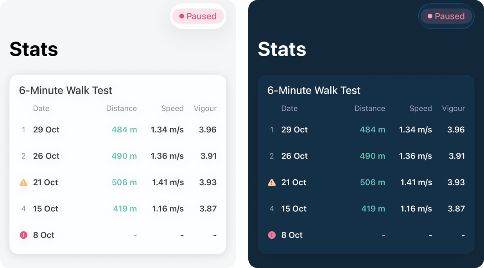

```swift
// WalkTestResultsCard.swift
import SwiftUI
import TrackerSDK

struct WalkTestResultsCard: View {
    var limit = 5

    @Environment(TrackerModel.self) private var model
    @Environment(\.trackerTheme) private var theme
    @State private var tests: [WalkTestResult]?
    @State private var failed = false
    @State private var explaining: WalkTestResult?

    var body: some View {
        VStack(alignment: .leading, spacing: 12) {
            Text("6-Minute Walk Test").font(theme.titleFont)

            if let tests, tests.isEmpty {
                Text("No results yet. A completed test shows here a few minutes after it's uploaded.")
                    .font(theme.bodyFont)
                    .foregroundStyle(theme.secondaryText)
            } else if let tests {
                header
                ForEach(Array(tests.prefix(limit).enumerated()), id: \.element.id) { index, test in
                    row(number: index + 1, test)
                }
            } else if failed {
                Text("Couldn't load your results.")
                    .font(theme.bodyFont)
                    .foregroundStyle(theme.secondaryText)
            } else {
                ProgressView().frame(maxWidth: .infinity)
            }
        }
        .foregroundStyle(theme.text)
        .trackerCard()
        .task(id: model.status?.sync.lastSyncedAt) { await load() }
        .alert(
            explaining?.flag == .invalid ? "Invalid test" : "Anomalies found",
            isPresented: Binding(get: { explaining != nil }, set: { if !$0 { explaining = nil } }),
            presenting: explaining
        ) { _ in
            Button("OK", role: .cancel) {}
        } message: { test in
            Text(test.flag == .invalid
                 ? "This test was considered invalid. Please repeat the test."
                 : "Some anomalies were found while processing this test. We recommend repeating the test to make sure the results are valid.")
        }
    }

    private func load() async {
        do {
            tests = try await KinetikosAPI.walkTests().filter { $0.flag != .noData }
            failed = false
        } catch {
            failed = tests == nil
        }
    }

    private var header: some View {
        HStack(spacing: 8) {
            Spacer().frame(width: 16)
            Text("Date").frame(maxWidth: .infinity, alignment: .leading)
            Text("Distance").frame(width: 62, alignment: .trailing)
            Text("Speed").frame(width: 72, alignment: .trailing)
            Text("Vigour").frame(width: 48, alignment: .trailing)
        }
        .font(theme.captionFont)
        .foregroundStyle(theme.secondaryText)
    }

    private func row(number: Int, _ test: WalkTestResult) -> some View {
        let invalid = test.flag == .invalid
        return HStack(spacing: 8) {
            Group {
                switch test.flag {
                case .invalid?:
                    Image(systemName: "exclamationmark.circle.fill").foregroundStyle(theme.error)
                case .doubtful?:
                    Image(systemName: "exclamationmark.triangle.fill").foregroundStyle(theme.warning)
                default:
                    Text("\(number)").foregroundStyle(theme.secondaryText)
                }
            }
            .font(theme.captionFont)
            .frame(width: 16)

            Text(test.day?.formatted(.dateTime.day().month(.abbreviated)) ?? test.dateRef ?? "—")
                .frame(maxWidth: .infinity, alignment: .leading)
            Text(invalid ? "-" : test.stepDistance.map { "\(Int($0.rounded())) m" } ?? "—")
                .foregroundStyle(theme.primary)
                .frame(width: 62, alignment: .trailing)
            Text(invalid ? "-" : test.velocity.map { String(format: "%.2f m/s", $0) } ?? "—")
                .frame(width: 72, alignment: .trailing)
            Text(invalid ? "-" : test.mets.map { String(format: "%.2f", $0) } ?? "—")
                .frame(width: 48, alignment: .trailing)
        }
        .font(theme.bodyFont.bold())
        .padding(.vertical, 8)
        .contentShape(Rectangle())
        .onTapGesture {
            if test.flag != nil { explaining = test }
        }
    }
}
```

### 9.11 About You

The four values in a settings `List`, read-only once complete and with an Edit button. `isComplete` tells the rest of your app, e.g. to unlock the walk test.

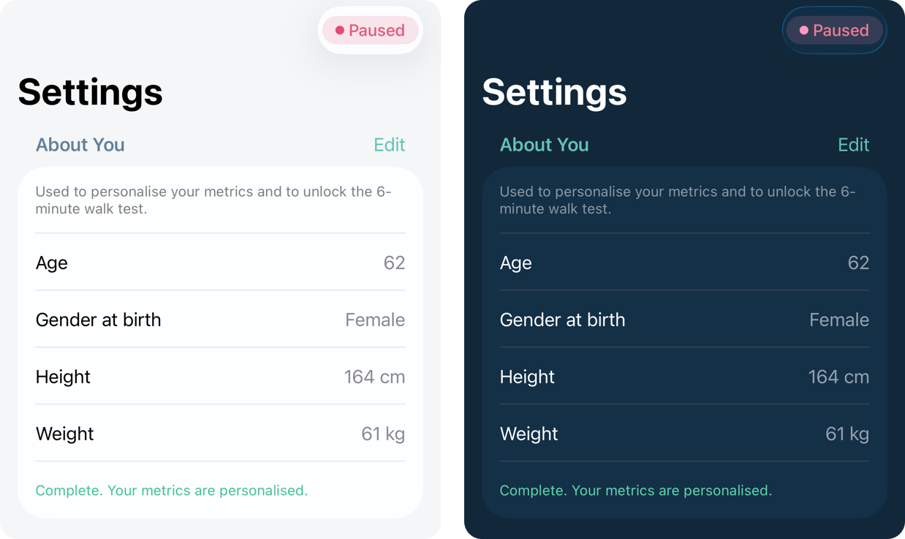

```swift
// AboutYouSection.swift
import SwiftUI

struct AboutYouSection: View {
    @Binding var isComplete: Bool

    @Environment(\.trackerTheme) private var theme
    @State private var loading = true
    @State private var editing = false
    @State private var saving = false
    @State private var problem: String?
    @State private var birthDate = Date()
    @State private var hasBirthDate = false
    @State private var gender = ""
    @State private var height = ""
    @State private var weight = ""

    var body: some View {
        Section {
            Text("Used to personalise your metrics and to unlock the 6-minute walk test.")
                .font(theme.captionFont)
                .foregroundStyle(.secondary)

            if loading {
                ProgressView().frame(maxWidth: .infinity)
            } else if editing {
                DatePicker("Date of birth", selection: $birthDate, in: Self.oldest...Date(), displayedComponents: .date)
                    .onChange(of: birthDate) { hasBirthDate = true }
                Picker("Gender at birth", selection: $gender) {
                    Text("Select").tag("")
                    Text("Male").tag("male")
                    Text("Female").tag("female")
                }
                numberField("Height", unit: "cm", text: $height)
                numberField("Weight", unit: "kg", text: $weight)
                if let problem {
                    Text(problem).font(theme.captionFont).foregroundStyle(theme.error)
                }
            } else {
                LabeledContent("Age", value: "\(Calendar.current.dateComponents([.year], from: birthDate, to: Date()).year ?? 0)")
                LabeledContent("Gender at birth", value: gender.capitalized)
                LabeledContent("Height", value: "\(height) cm")
                LabeledContent("Weight", value: "\(weight) kg")
            }

            if !loading {
                Text(isComplete ? "Complete. Your metrics are personalised." : "Fill in all four fields to complete your profile.")
                    .font(theme.captionFont)
                    .foregroundStyle(isComplete ? theme.success : .secondary)
            }
        } header: {
            HStack {
                Text("About You").foregroundStyle(theme.sectionTitle)
                Spacer()
                if !loading {
                    if editing {
                        Button("Save") { Task { await save() } }
                            .disabled(saving || entered == nil)
                    } else {
                        Button("Edit") { editing = true }
                    }
                }
            }
        }
        .listRowBackground(theme.cardBackground)
        .task { await load() }
    }

    private func numberField(_ label: String, unit: String, text: Binding<String>) -> some View {
        HStack {
            Text(label)
            Spacer()
            TextField(unit, text: text)
                .keyboardType(.decimalPad)
                .multilineTextAlignment(.trailing)
        }
    }

    /// What was entered, if all four are valid.
    private var entered: Demographics? {
        guard hasBirthDate, !gender.isEmpty,
              let height = Self.number(height, in: 50...260),
              let weight = Self.number(weight, in: 10...400) else { return nil }
        return Demographics(
            dateOfBirth: kinetikosDayString(birthDate),
            genderAtBirth: gender, heightCm: height, weightKg: weight
        )
    }

    private func load() async {
        defer { loading = false }
        guard let saved = try? await KinetikosAPI.demographics() else {
            editing = true
            return
        }
        if let date = saved.dateOfBirth.flatMap(kinetikosDay) {
            birthDate = date
            hasBirthDate = true
        }
        gender = saved.genderAtBirth ?? ""
        height = saved.heightCm.map { $0.formatted() } ?? ""
        weight = saved.weightKg.map { $0.formatted() } ?? ""
        isComplete = saved.isComplete
        editing = !saved.isComplete
    }

    private func save() async {
        guard let entered else { return }
        saving = true
        defer { saving = false }
        do {
            isComplete = try await KinetikosAPI.saveDemographics(entered).isComplete
            editing = false
            problem = nil
        } catch {
            problem = "Couldn't save. Please try again."
        }
    }

    /// Accepts a comma as the decimal separator.
    private static func number(_ text: String, in range: ClosedRange<Double>) -> Double? {
        guard let value = Double(text.replacingOccurrences(of: ",", with: ".")), range.contains(value) else { return nil }
        return value
    }

    private static var oldest: Date {
        Calendar.current.date(byAdding: .year, value: -120, to: Date()) ?? .distantPast
    }
}
```

### 9.12 Gait Vitals

Yesterday's walking against the person's usual range, as on the tracKer app's Stats tab: a band for the usual range, a strip above and below it for outliers, and one point per metric, coloured typical, mild or outlier. Tapping a point gives its figures. With no walking yesterday, the graph is empty and says so. The ⓘ explains the card; `TrackerHelpButton` and `TrackerHelpSheet` are used by §9.13 too.

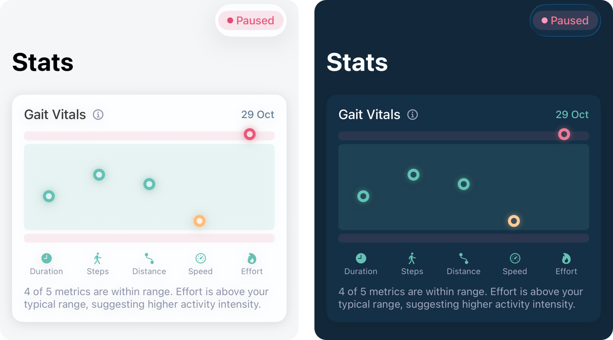

```swift
// GaitVitalsCard.swift
import SwiftUI

struct GaitVitalsCard: View {
    /// Nil shows the empty graph.
    let report: GaitVitalsReport?

    @Environment(\.trackerTheme) private var theme
    @State private var appeared = false
    @State private var selected: GaitMetric?
    @State private var showingHelp = false

    /// The outlier strips, the gap between them and the band, and a point.
    private let strip: CGFloat = 12
    private let gap: CGFloat = 5
    private let point: CGFloat = 12

    var body: some View {
        let vitals = report?.gaitVitals.vitals ?? []

        VStack(alignment: .leading, spacing: 12) {
            HStack(spacing: 8) {
                Text("Gait Vitals").font(theme.titleFont)
                TrackerHelpButton(label: "About Gait Vitals") { showingHelp = true }
                Spacer()
                if let day = report?.day {
                    Text(day.formatted(.dateTime.day().month(.abbreviated)))
                        .font(theme.emphasisFont)
                        .foregroundStyle(theme.sectionTitle)
                }
            }

            graph(vitals)
                .frame(height: 150)

            HStack {
                ForEach(vitals.isEmpty ? GaitMetric.allCases : vitals.map(\.metric)) { metric in
                    VStack(spacing: 2) {
                        Image(systemName: metric.symbol)
                            .font(.system(size: 14))
                            .foregroundStyle(theme.primary)
                            .frame(height: 18)
                        Text(metric.title)
                            .font(.system(size: 11))
                            .foregroundStyle(theme.secondaryText)
                            .lineLimit(1)
                            .minimumScaleFactor(0.7)
                    }
                    .frame(maxWidth: .infinity)
                    .opacity(selected == nil || selected == metric ? 1 : 0.4)
                }
            }

            Text(caption(vitals))
                .font(theme.bodyFont)
                .foregroundStyle(theme.secondaryText)
                .fixedSize(horizontal: false, vertical: true)
        }
        .foregroundStyle(theme.text)
        .trackerCard()
        .onAppear { appeared = true }
        .onChange(of: report?.date) { selected = nil }
        .sheet(isPresented: $showingHelp) {
            TrackerHelpSheet(title: "About Gait Vitals", text: Self.help)
        }
    }

    private func graph(_ vitals: [GaitVitals.Vital]) -> some View {
        GeometryReader { geo in
            let column = geo.size.width / CGFloat(max(vitals.count, 1))

            ZStack {
                VStack(spacing: gap) {
                    RoundedRectangle(cornerRadius: 5).fill(theme.error.opacity(0.10)).frame(height: strip)
                    RoundedRectangle(cornerRadius: 6).fill(theme.primary.opacity(0.12))
                    RoundedRectangle(cornerRadius: 5).fill(theme.error.opacity(0.10)).frame(height: strip)
                }

                ForEach(Array(vitals.enumerated()), id: \.element.id) { index, vital in
                    let color = color(vital.level)
                    Circle()
                        .fill(theme.cardBackground)
                        .overlay(Circle().stroke(color, lineWidth: 4))
                        .frame(width: point, height: point)
                        .scaleEffect(selected == vital.metric ? 1.4 : 1)
                        .shadow(color: color.opacity(0.4), radius: 4)
                        .position(
                            x: column * (CGFloat(index) + 0.5),
                            y: appeared ? y(vital.z, height: geo.size.height) : geo.size.height / 2
                        )
                        .animation(.easeOut(duration: 0.5).delay(Double(index) * 0.08), value: appeared)
                        .accessibilityLabel("\(vital.metric.title): \(label(vital.level))")
                }

                // One tap target per column.
                HStack(spacing: 0) {
                    ForEach(vitals) { vital in
                        Color.clear
                            .contentShape(Rectangle())
                            .onTapGesture { selected = selected == vital.metric ? nil : vital.metric }
                    }
                }
                .accessibilityHidden(true)
            }
        }
    }

    /// Where a point sits: outliers (|z| ≥ 2) in the strips, the rest in the band,
    /// mild ones (1 ≤ |z| < 2) at its edges.
    private func y(_ z: Double, height: CGFloat) -> CGFloat {
        let z = min(max(z, -3), 3)
        if z >= 2 { return strip / 2 * (1 - CGFloat(z - 2)) }
        if z <= -2 { return height - strip / 2 * (1 - CGFloat(-2 - z)) }
        let top = strip + gap + point / 2
        let bottom = height - strip - gap - point / 2
        let edge = (bottom - top) * 0.10
        if z > 1 { return top + edge * (2 - CGFloat(z)) }
        if z < -1 { return bottom - edge * (2 + CGFloat(z)) }
        return bottom - edge - (bottom - top - 2 * edge) * CGFloat((z + 1) / 2)
    }

    private func color(_ level: GaitVitals.Level) -> Color {
        switch level {
        case .typical: theme.primary
        case .mild: theme.warning
        case .outlier: theme.error
        }
    }

    private func label(_ level: GaitVitals.Level) -> String {
        switch level {
        case .typical: "Typical"
        case .mild: "Mild deviation"
        case .outlier: "Outside typical range"
        }
    }

    private func caption(_ vitals: [GaitVitals.Vital]) -> String {
        if let vital = vitals.first(where: { $0.metric == selected }) {
            let metric = vital.metric
            return "\(metric.title), \(label(vital.level).lowercased()): \(metric.formatted(vital.value)) \(metric.unit), "
                + "usually \(metric.formatted(vital.med)) \(metric.unit)."
        }
        guard let summary = report?.gaitVitals.summary else { return "No data recorded" }
        if summary.above.isEmpty && summary.below.isEmpty {
            return "All metrics are within your typical range. Your movement pattern is consistent."
        }
        var parts: [String] = []
        if summary.within > 0 {
            parts.append("\(summary.within) of \(summary.total) metrics are within range.")
        }
        if !summary.above.isEmpty {
            parts.append("\(names(summary.above)) \(summary.above.count == 1 ? "is" : "are") above your typical range, suggesting higher activity intensity.")
        }
        if !summary.below.isEmpty {
            parts.append("\(names(summary.below)) \(summary.below.count == 1 ? "is" : "are") below your typical range, suggesting reduced activity.")
        }
        return parts.joined(separator: " ")
    }

    private func names(_ metrics: [GaitMetric]) -> String {
        metrics.map(\.title).formatted(.list(type: .and))
    }

    static let help = """
        Gait Vitals compare yesterday's walking with your typical range across duration, steps, distance, speed, and effort. Your typical range comes from up to the previous 90 days of walking. If you didn't walk yesterday, the graph is empty.

        Green points are within your typical range. Orange points show mild deviations near the edge of your typical range. Red points are outside your typical range and may reflect an unusual walking day.
        """
}

/// The ⓘ beside a card's title.
struct TrackerHelpButton: View {
    let label: String
    let action: () -> Void
    @Environment(\.trackerTheme) private var theme

    var body: some View {
        Button(action: action) {
            Image(systemName: "info.circle")
                .font(.system(size: 14, weight: .medium))
                .foregroundStyle(theme.secondaryText)
        }
        .buttonStyle(.plain)
        .accessibilityLabel(label)
    }
}

/// What the ⓘ opens.
struct TrackerHelpSheet: View {
    let title: String
    let text: String
    @Environment(\.trackerTheme) private var theme
    @Environment(\.dismiss) private var dismiss

    var body: some View {
        NavigationStack {
            ScrollView {
                Text(text)
                    .font(theme.bodyFont)
                    .foregroundStyle(theme.text)
                    .frame(maxWidth: .infinity, alignment: .leading)
                    .padding(16)
            }
            .background(theme.screenBackground)
            .navigationTitle(title)
            .navigationBarTitleDisplayMode(.inline)
            .toolbar {
                ToolbarItem(placement: .confirmationAction) {
                    Button("Done") { dismiss() }
                }
            }
        }
        .presentationDetents([.medium, .large])
    }
}
```

### 9.13 Walking pattern

When the person usually walks, one metric at a time: a bar for each hour of the day and for each day of the week, the median of up to 90 days. The weekly chart's line is the average of its seven bars. Touching a bar gives its value.

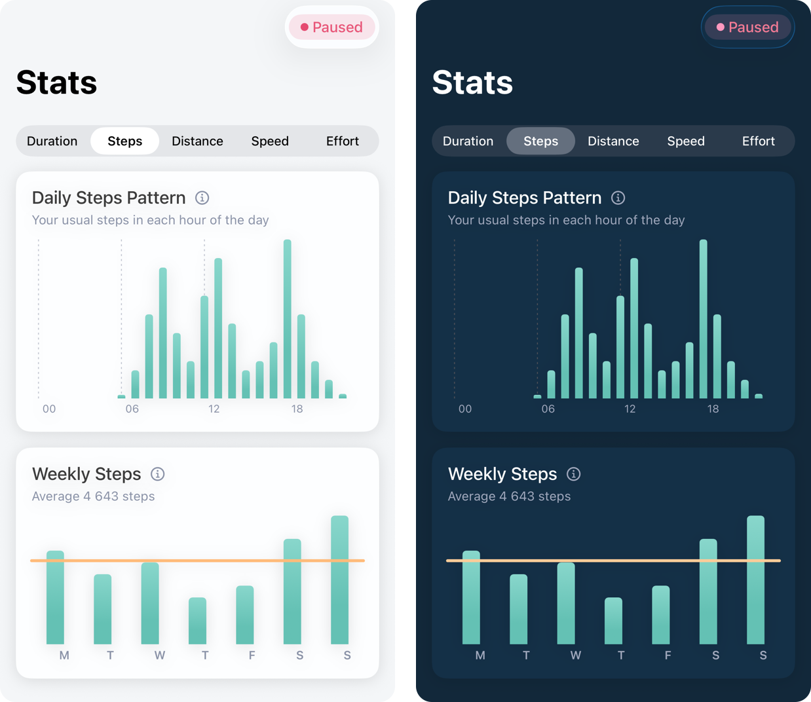

```swift
// WalkingPatternCards.swift
import SwiftUI
import Charts

struct WalkingPatternCards: View {
    let report: GaitVitalsReport
    @State private var metric: GaitMetric = .steps

    var body: some View {
        VStack(spacing: 16) {
            Picker("Metric", selection: $metric) {
                ForEach(GaitMetric.allCases) { Text($0.title).tag($0) }
            }
            .pickerStyle(.segmented)

            DailyPatternCard(metric: metric, values: report.dailyPattern[metric])
            WeeklyPatternCard(metric: metric, values: report.weeklyPattern[metric])
        }
    }
}

struct DailyPatternCard: View {
    let metric: GaitMetric
    /// 24 values, midnight first.
    let values: [Double?]

    @Environment(\.trackerTheme) private var theme
    @State private var hour: Int?
    @State private var showingHelp = false

    var body: some View {
        VStack(alignment: .leading, spacing: 12) {
            PatternHeader(title: "Daily \(metric.title) Pattern", metric: metric, detail: detail) { showingHelp = true }

            if values.contains(where: { ($0 ?? 0) > 0 }) {
                Chart {
                    ForEach(Array(values.enumerated()), id: \.offset) { slot, value in
                        if let value {
                            BarMark(x: .value("Hour", slot), y: .value(metric.title, value), width: .fixed(8))
                                .foregroundStyle(theme.primary.gradient)
                                .cornerRadius(3)
                                .opacity(hour == nil || hour == slot ? 1 : 0.4)
                        }
                    }
                }
                .chartXScale(domain: -0.5...23.5)
                .chartYAxis(.hidden)
                .chartXAxis {
                    AxisMarks(values: [0, 6, 12, 18]) { value in
                        AxisGridLine(stroke: StrokeStyle(lineWidth: 1, dash: [2, 3]))
                            .foregroundStyle(theme.separator)
                        AxisValueLabel {
                            if let slot = value.as(Int.self) {
                                Text(Self.start(of: slot).formatted(.dateTime.hour()))
                                    .font(.system(size: 11))
                                    .foregroundStyle(theme.secondaryText)
                            }
                        }
                    }
                }
                .chartXSelection(value: $hour)
                .frame(height: 180)
            } else {
                EmptyPattern()
            }
        }
        .foregroundStyle(theme.text)
        .trackerCard()
        .onChange(of: metric) { hour = nil }
        .sheet(isPresented: $showingHelp) {
            TrackerHelpSheet(title: "About \(metric.title)", text: metric.help)
        }
    }

    private var detail: String {
        guard let hour, values.indices.contains(hour), let value = values[hour] else {
            return "Your usual \(metric.title.lowercased()) in each hour of the day"
        }
        let time = Date.FormatStyle.dateTime.hour().minute()
        return "\(Self.start(of: hour).formatted(time)) – \(Self.start(of: hour + 1).formatted(time)): "
            + "\(metric.formatted(value)) \(metric.unit)"
    }

    private static func start(of hour: Int) -> Date {
        Calendar.current.startOfDay(for: .now).addingTimeInterval(TimeInterval(hour) * 3600)
    }
}

struct WeeklyPatternCard: View {
    let metric: GaitMetric
    /// 7 values, Monday first.
    let values: [Double?]

    @Environment(\.trackerTheme) private var theme
    @State private var day: Int?
    @State private var showingHelp = false

    var body: some View {
        VStack(alignment: .leading, spacing: 12) {
            PatternHeader(title: "Weekly \(metric.title)", metric: metric, detail: detail) { showingHelp = true }

            if values.contains(where: { ($0 ?? 0) > 0 }) {
                Chart {
                    ForEach(Array(values.enumerated()), id: \.offset) { slot, value in
                        if let value {
                            BarMark(x: .value("Day", slot), y: .value(metric.title, value), width: .fixed(18))
                                .foregroundStyle(theme.primary.gradient)
                                .cornerRadius(4)
                                .opacity(day == nil || day == slot ? 1 : 0.4)
                        }
                    }
                    if let average {
                        RuleMark(y: .value("Average", average))
                            .foregroundStyle(theme.warning)
                            .lineStyle(StrokeStyle(lineWidth: 3, lineCap: .round))
                    }
                }
                .chartXScale(domain: -0.5...6.5)
                .chartYAxis(.hidden)
                .chartXAxis {
                    AxisMarks(values: Array(0..<7)) { value in
                        AxisValueLabel {
                            if let slot = value.as(Int.self) {
                                Text(Calendar.current.veryShortWeekdaySymbols[(slot + 1) % 7])
                                    .font(.system(size: 12, weight: .semibold))
                                    .foregroundStyle(theme.secondaryText)
                            }
                        }
                    }
                }
                .chartXSelection(value: $day)
                .frame(height: 150)
            } else {
                EmptyPattern()
            }
        }
        .foregroundStyle(theme.text)
        .trackerCard()
        .onChange(of: metric) { day = nil }
        .sheet(isPresented: $showingHelp) {
            TrackerHelpSheet(title: "About \(metric.title)", text: metric.help)
        }
    }

    /// The average of the seven bars.
    private var average: Double? {
        let known = values.compactMap { $0 }
        return known.isEmpty ? nil : known.reduce(0, +) / Double(known.count)
    }

    private var detail: String {
        if let day, values.indices.contains(day), let value = values[day] {
            // Monday first here; weekdaySymbols start on Sunday.
            return "\(Calendar.current.weekdaySymbols[(day + 1) % 7]): \(metric.formatted(value)) \(metric.unit)"
        }
        return average.map { "Average \(metric.formatted($0)) \(metric.unit)" } ?? " "
    }
}

private struct PatternHeader: View {
    let title: String
    let metric: GaitMetric
    let detail: String
    let onHelp: () -> Void
    @Environment(\.trackerTheme) private var theme

    var body: some View {
        VStack(alignment: .leading, spacing: 4) {
            HStack(spacing: 8) {
                Text(title).font(theme.titleFont)
                TrackerHelpButton(label: "About \(metric.title)", action: onHelp)
            }
            Text(detail)
                .font(theme.captionFont)
                .foregroundStyle(theme.secondaryText)
        }
    }
}

private struct EmptyPattern: View {
    @Environment(\.trackerTheme) private var theme

    var body: some View {
        Text("Not enough walking yet to show a pattern.")
            .font(theme.bodyFont)
            .foregroundStyle(theme.secondaryText)
            .frame(maxWidth: .infinity, minHeight: 80)
    }
}

extension GaitMetric {
    /// What the ⓘ on the pattern cards says.
    var help: String {
        let about = switch self {
        case .duration:
            "Duration is the time you spend walking, shown in minutes. It adds together the time taken by each step detected as you walk."
        case .steps:
            "Step count is the number of steps you take while walking, detected from the movement your phone's motion sensors record."
        case .distance:
            "Distance is how far you walk, shown in metres. The length of each step is estimated from your phone's motion sensors, and the lengths added together."
        case .speed:
            "Speed is how fast you walk, shown in metres per second, estimated from the length and timing of your steps."
        case .vigour:
            "Effort measures how much work your body does while walking, combining how briskly you walk with how long you walk for. It's measured in MET-minutes: a MET compares the energy you use while moving with the energy you use at rest, so walking for 10 minutes at 3 METs adds up to 30 MET-minutes."
        }
        return about + """


            Each bar shows your median over up to your last 90 days: for each hour of the day on the daily chart, and for each day of the week on the weekly chart. Only hours when you walked are counted, so a bar shows what's usual when you do walk at that time, not how often you walk then. The median is the middle value, so one unusual day has little effect.

            On the weekly chart, the line shows the average of the seven bars.
            """
    }
}
```

### 9.14 Walking this week

`RecordedWeekCard` (§9.6) with Kinetikos' figures: each bar is how much of the day was walking, once Kinetikos has analysed the recording. A day not analysed yet has no bar, and a partly analysed one is lighter, since it can still grow. The average counts only the days that won't change. Tapping a day shows its walking time beside its recorded time. Until Kinetikos answers, or when it has no analysis for the participant yet, the card shows recorded time instead. Analysis finishes with nothing on the phone to hear about it, so the card looks again whenever the app comes back to the foreground.

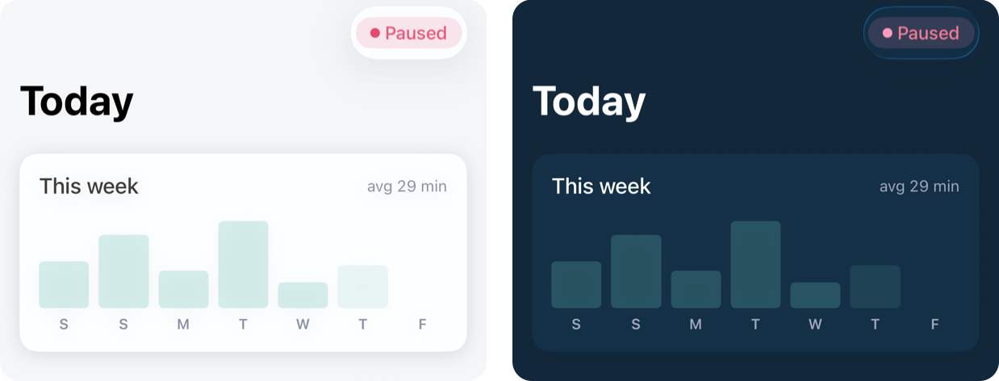

```swift
// WalkingWeekCard.swift
import SwiftUI
import TrackerSDK

struct WalkingWeekCard: View {
    @Environment(TrackerModel.self) private var model
    @Environment(\.trackerTheme) private var theme
    @Environment(\.scenePhase) private var scenePhase
    @State private var week: WalkingWeek?
    @State private var selected: Date?

    private let plotHeight: CGFloat = 72

    var body: some View {
        let columns = self.columns
        let tallest = max(columns.compactMap(\.minutes).max() ?? 0, 1)
        let settled = columns.filter(\.countsInAverage).compactMap(\.minutes)
        let average = settled.isEmpty ? 0 : Int((settled.reduce(0, +) / Double(settled.count)).rounded())

        VStack(alignment: .leading, spacing: 16) {
            HStack {
                Text("This week").font(theme.titleFont)
                Spacer()
                Text("avg \(average) min").font(theme.captionFont).foregroundStyle(theme.secondaryText)
            }

            HStack(alignment: .bottom, spacing: 8) {
                ForEach(columns) { column in
                    VStack(spacing: 4) {
                        Spacer(minLength: 0)
                        if let minutes = column.minutes {
                            RoundedRectangle(cornerRadius: 4)
                                .fill(column.isToday ? AnyShapeStyle(theme.primary.gradient) : AnyShapeStyle(theme.primary.opacity(0.25)))
                                .opacity(column.analysis == .partial ? 0.5 : 1)
                                .frame(height: max(2, plotHeight * CGFloat(minutes / tallest)))
                        }
                        Text(column.day.formatted(.dateTime.weekday(.narrow)))
                            .font(.system(size: 12, weight: .semibold))
                            .foregroundStyle(selected == column.day ? theme.text : theme.secondaryText)
                            .frame(height: 18)
                    }
                    .frame(maxWidth: .infinity)
                    .contentShape(Rectangle())
                    .onTapGesture { selected = selected == column.day ? nil : column.day }
                    .accessibilityElement(children: .ignore)
                    .accessibilityLabel("\(column.day.formatted(.dateTime.weekday(.wide))), \(describe(column))")
                }
            }
            .frame(height: plotHeight + 22)

            if let column = columns.first(where: { $0.day == selected }) {
                let name = column.isToday ? "Today" : column.day.formatted(.dateTime.weekday(.wide).day().month(.abbreviated))
                Text("\(name): \(describe(column))")
                    .font(theme.captionFont)
                    .foregroundStyle(theme.secondaryText)
            }
        }
        .foregroundStyle(theme.text)
        .trackerCard()
        .task(id: model.status?.sync.lastSyncedAt) { await load() }
        .onChange(of: scenePhase) { _, phase in
            if phase == .active { Task { await load() } }
        }
    }

    private func load() async {
        if let fresh = try? await KinetikosAPI.walkingWeek() { week = fresh }
    }

    private struct Column: Identifiable {
        let day: Date
        /// The bar: walking time when `analysis` is set, recorded time otherwise. Nil, no bar.
        let minutes: Double?
        let recorded: Double
        let analysis: WalkingWeek.Analysis?

        var id: Date { day }
        var isToday: Bool { Calendar.current.isDateInToday(day) }
        /// A day still being analysed would drag the average down until it caught up.
        var countsInAverage: Bool { minutes != nil && (analysis?.isSettled ?? true) }
    }

    /// The phone's seven days, with Kinetikos' figures where it has them.
    private var columns: [Column] {
        let walking = week?.hasWalkingTime == true
        return model.recordedDays.map { local in
            let phone = Double(local.totalSeconds) / 60
            guard let server = week?.days.first(where: { $0.date == kinetikosDayString(local.day) }) else {
                return Column(day: local.day, minutes: phone, recorded: phone, analysis: nil)
            }
            // Uploads reach Kinetikos with a delay, so today takes the larger figure.
            let recorded = Calendar.current.isDateInToday(local.day) ? max(server.totalMinutes, phone) : server.totalMinutes
            guard walking else {
                return Column(day: local.day, minutes: recorded, recorded: recorded, analysis: nil)
            }
            return Column(day: local.day, minutes: server.processed?.walkingMinutes, recorded: recorded, analysis: server.processed?.status)
        }
    }

    private func describe(_ column: Column) -> String {
        let recorded = Int(column.recorded.rounded())
        guard let analysis = column.analysis else {
            return column.minutes.map { "\(Int($0.rounded())) min" } ?? "No data"
        }
        var text: String
        if analysis == .pending {
            text = "Processing… \(recorded) min recorded"
        } else if let walking = column.minutes.map({ Int($0.rounded()) }) {
            text = analysis == .partial
                ? "\(walking) min walking so far · \(recorded) min recorded"
                : "\(walking) min walking · \(recorded) min recorded"
        } else {
            text = "No data · \(recorded) min recorded"
        }
        if analysis == .failed { text += ". Couldn't analyse some recordings." }
        return text
    }
}
```

### 9.15 Putting it together

Four tabs, like the tracKer app: Today, Walk, Stats and Settings. The Consent screen opens by itself while Consent is missing.

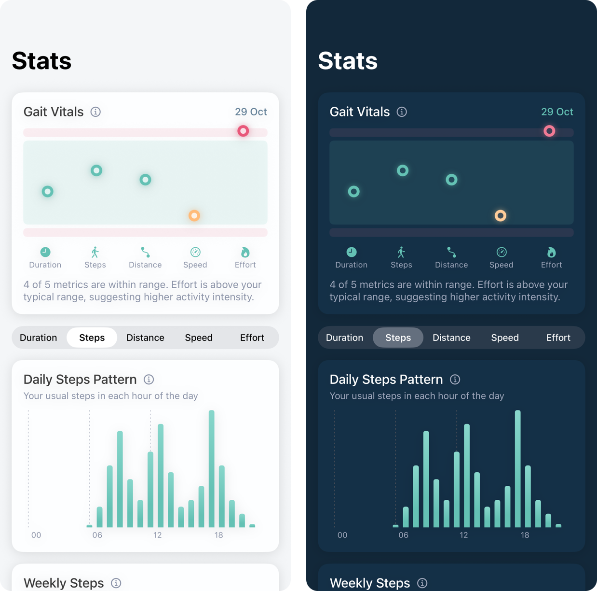

```swift
// TrackerTabs.swift
import SwiftUI
import TrackerSDK

struct TrackerTabs: View {
    @State private var model = TrackerModel()
    @State private var tab = 0
    @State private var showConsent = false
    @State private var aboutYouComplete = false
    @Environment(\.trackerTheme) private var theme
    @Environment(\.scenePhase) private var scenePhase

    var body: some View {
        TabView(selection: $tab) {
            NavigationStack {
                ScrollView {
                    VStack(spacing: 16) {
                        TrackerNotice { showConsent = true }
                        RecordedTodayCard()
                        RecordWalkCard { tab = 1 }
                        WalkingWeekCard()
                    }
                    .padding(16)
                }
                .background(theme.screenBackground)
                .navigationTitle("Today")
                .toolbar { ToolbarItem { TrackerStatusBadge() } }
            }
            .tabItem { Label("Today", systemImage: "house") }
            .tag(0)

            WalkSessionView(walkTestLocked: !aboutYouComplete) { tab = 3 }
                .tabItem { Label("Walk", systemImage: "figure.walk") }
                .tag(1)

            NavigationStack {
                TrackerStatsView()
                    .navigationTitle("Stats")
            }
            .tabItem { Label("Stats", systemImage: "chart.bar") }
            .tag(2)

            NavigationStack {
                List {
                    AboutYouSection(isComplete: $aboutYouComplete)
                    CloudSyncSection()
                    TrackerPermissionsSection()
                    ParticipationSection(onGiveConsent: { showConsent = true }) {
                        // Your own sign-out goes here.
                    }
                    TrackerSupportSection()
                }
                .scrollContentBackground(.hidden)
                .background(theme.screenBackground)
                .navigationTitle("Settings")
            }
            .tabItem { Label("Settings", systemImage: "gearshape") }
            .tag(3)
        }
        .tint(theme.primary)
        .environment(model)
        .task { await model.follow() }
        .task { aboutYouComplete = (try? await KinetikosAPI.demographics())?.isComplete ?? false }
        .onChange(of: scenePhase) { _, phase in
            if phase == .active { Task { await model.refresh() } }
        }
        .onChange(of: model.status?.state) { _, state in
            if state == .needsConsent { showConsent = true }
        }
        .fullScreenCover(isPresented: $showConsent) {
            TrackerConsentView(onDone: { showConsent = false }, onNotNow: { showConsent = false })
        }
    }
}

/// Gait Vitals, the walking pattern and walk-test results, as on the tracKer app's Stats tab.
struct TrackerStatsView: View {
    @Environment(\.trackerTheme) private var theme
    @Environment(\.scenePhase) private var scenePhase
    @State private var report: GaitVitalsReport?
    @State private var loading = true
    @State private var failed = false

    var body: some View {
        ScrollView {
            VStack(spacing: 16) {
                if let report {
                    GaitVitalsCard(report: report)
                    if report.hasPattern {
                        WalkingPatternCards(report: report)
                    }
                } else if loading {
                    ProgressView().frame(maxWidth: .infinity).padding(.vertical, 40)
                } else if failed {
                    Text("Couldn't load your Gait Vitals. Pull down to try again.")
                        .font(theme.bodyFont)
                        .foregroundStyle(theme.secondaryText)
                        .trackerCard()
                }

                WalkTestResultsCard()

                Text("Data computed from your last 90 days of walking activity.")
                    .font(theme.captionFont)
                    .foregroundStyle(theme.secondaryText)
            }
            .padding(16)
        }
        .background(theme.screenBackground)
        .refreshable { await load() }
        .task { await load() }
        // Yesterday moves on at midnight.
        .onChange(of: scenePhase) { _, phase in
            if phase == .active { Task { await load() } }
        }
    }

    private func load() async {
        defer { loading = false }
        do {
            report = try await KinetikosAPI.gaitVitals()
            failed = false
        } catch {
            failed = true
        }
    }
}
```
